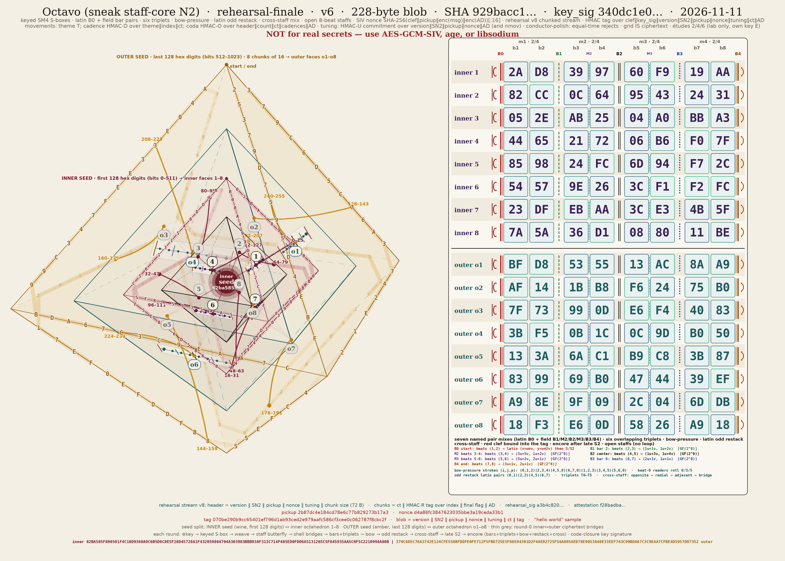

<p align="center"></p>
<p align="center"></p>

## Current live revision — rehearsal-finale (2026-11-11, frozen as octavo011)

Rehearsal-finale applies the fixes suggested by the third rehearsal attack
(`attacks_octavo_rehearsalpolish/REPORT.md`: 0 High, 0 Medium, 3 Low, 9 Info,
no cryptographic break of v8). As in rehearsal-polish, every change is in the
file helpers, the worker plumbing and the streaming API. **v6 and v7 are
byte-identical to octavo010**, `EXPECTED_MIX_SHA256` and `key_sig` did not
move, and **v8 headers and ciphertext blocks are byte-identical to
rehearsal-polish** for the same pickup and nonce. Only the v8 chunk **tags**
changed, again because the rehearsal digest attests all v8 API code, so
rehearsal-polish v8 streams do not open here (v8 was never published). Still
N2 / SN2 (project name: Octavo), still homemade, **not for real secrets**
(use AES-GCM-SIV, age or libsodium). These fixes have not been attacked
again. The picture was re-rendered.

- **L1, copy fallback.** When hard links are unavailable, the copy's
  descriptor now stays **open** through the inode check and until the helper
  returns, so its inode number cannot be freed and handed to a file someone
  creates at dst in the gap. A substitute is refused (`RuntimeError`) and
  removed.
- **L2, the warning is no longer lost.** `UnfinalizedStreamWarning` is raised
  outside the destructor's own `try/except`, so under `-W error` it reaches
  `sys.unraisablehook` ("Exception ignored in … UnfinalizedStreamWarning" on
  stderr) instead of vanishing. A destructor still cannot fail the program
  (exit code unchanged). An `always` filter for this category is appended at
  import, so **every** dropped decryptor warns, not once per call site; your
  own `-W` / `PYTHONWARNINGS` / `simplefilter` settings come first and still
  win (`-W ignore` silences it).
- **L3, no file probe.** `iter_rehearsal` never consults the filesystem for a
  `bytes` src: bytes are always ciphertext, and a non-stream gets the same
  `UnsupportedVersion` whether or not it names a file (the rehearsal-polish
  `TypeError` guard is gone).
- **I1/I2, overwrite.** `overwrite=True` onto a missing dst now links
  directly (no hidden name). Onto an existing dst it links to a fresh
  `.swap` name and swaps it with dst atomically (Linux `renameat2`
  `RENAME_EXCHANGE`, via ctypes). If dst is then not this call's file, it
  swaps back, so **a refused race keeps the caller's old dst**. Without
  `renameat2` (other OS, old libc, unsupported filesystem) it falls back to
  `os.replace` plus the check, where a refused race can still cost the old dst.
  **A crash during an `overwrite=True` commit can leave a 0600
  `.<dst>.XXXXXXXX.swap` file** holding the new plaintext or the old dst. With
  `O_TMPFILE`, a crash *mid-stream* leaves nothing. Clean up stale `.*.swap`,
  `.*.tmp` and `.*.partial` dot-files after a crash.
- **I3, no silent loss.** On the `O_TMPFILE` path, any `/proc` link failure
  (ENOENT, EACCES: odd `/proc`, hidepid, sandboxes) falls back to the copy,
  because the verified bytes are still in the descriptor. `keep_partial` falls
  back to a fresh dot-name on **any** error for `dst.partial` (taken,
  ENAMETOOLONG for a 248+ byte dst, a refused race). If keeping still fails,
  the reason is on the exception as `partial_error`. If the whole stream
  verified but publishing failed (dst appeared with `overwrite=False`), the
  kept file is `dst.complete`, not `dst.partial`.
- **I4, same file.** The same-file check is repeated relative to the opened
  directory fd, and again just before publishing, so a parent-symlink swap
  can no longer make `overwrite=True` replace the ciphertext source with its
  own plaintext (`ValueError`).
- **I5, executed bytecode.** At import the module compiles `_MODULE_SOURCE`
  and requires every function and method it defined to have exactly that
  code object. A `.pyc` built from different source (same size and mtime) or
  a `.py` swapped between Python's read and the snapshot makes the import fail
  (`RuntimeError`, "executed bytecode … does not match"). Module-level
  statements are not compared; the data the digests name is hashed from live
  values.
- **I6, workers.** Workers start as `python -I -B -S -c …` with an **empty
  environment** (no `site`, so no `.pth` files; no `LD_PRELOAD`,
  `LD_LIBRARY_PATH` or locale variables; on Windows only `SYSTEMROOT`). The
  parent spot-checks **one random block per batch** against its own
  computation and kills the workers on a mismatch (`RuntimeError`). That is a
  spot check, not a proof: workers stay in the trusted base, together with
  `sys.executable`, the interpreter and the stdlib.
- **I7, `read_size`.** Must be an `int` (not `bool`) ≥ 1 on
  `decrypt_rehearsal_file`, `iter_rehearsal` and `encrypt_rehearsal_file`
  (`None` keeps encrypt's default): 0 or −1 raise `ValueError`, `True`,
  `1.5` or `"8"` raise `TypeError`.
- **I8, rejects keep nothing.** On a bad final padding (only a seed holder can
  build such a stream) the decrypted chunk list is cleared, and the streaming
  `padded`/`msg` dropped, before `AuthError` is raised, so no plaintext is
  reachable from the traceback.
- **Not fixed, on purpose: `load_seed()`'s unclosed file handle** (it is
  mix-attested; touching it would move `EXPECTED_MIX_SHA256`, `key_sig` and
  every v6/v7 blob). I9 needed nothing; `workers` still raises `ValueError`
  for a bad type.

- Live `sneak_n2.py` SHA-256: `929bacc1bef5ebd6dee7df817aba6061ca58e871d4a18992d33fc0bc107b772f`.
- `EXPECTED_MIX_SHA256`: `fe93996970ecd92693b5f8f43ffb2cad5e96867f258a38b12637f1014b12b4c6` (unchanged).
- key_sig (demo seed): `340dc1e062502bb13462a94ba490c3dc` (unchanged).
- `EXPECTED_REHEARSAL_SHA256`: `f28badba6dcd70e80f2524d9adb00bc177374d609a0555453256fa10451804a4` (was `dd02f707…`).
- rehearsal_sig (demo seed): `a3b4c820528562ac17a74eb414a389a3` (was `1f8097d2…`).
- hello-world and movements-demo blobs: unchanged from octavo010.
- `rehearsal-demo.txt`: re-sealed with the **same** pickup and nonce as the
  rehearsal-polish sample; header and both ciphertext chunks identical, only
  the two tags differ.
- Score: `score/vectors.json`, score version 7, 72 vectors. The 64 étude
  vectors are unchanged; the 8 rehearsal vectors were regenerated and only
  their tags differ from score version 6
  (`rehearsalfinale_verification/v8_compare.txt`: 8/8).
- Tests: 459/459 passed (live, 21:46–21:55 ET, `rehearsalfinale_verification/test_run_live.txt`; and inside the frozen octavo011) (`python3 test_sneak_n2.py`, about 10 minutes). The new
  checks turn the rehearsal-polish attack's witnesses into regression tests.
- Witness rerun: `/workspace/rehearsalfinale_witness_rerun/` (`SUMMARY.txt`):
  L1–L3, I3–I8 and I1 on the `renameat2` path no longer reproduce; I1 on the
  `os.replace` fallback and the I2 `.swap` leftover remain (documented), as
  does the deliberate `load_seed` handle. v8 core, timing and v6/v7
  regression checks all hold.

---

## Previous revision — rehearsal-polish (2026-11-11, not frozen; attacked in `attacks_octavo_rehearsalpolish/`)

Rehearsal-polish applies the fixes suggested by the second rehearsal attack
(`attacks_octavo_rehearsalfix/REPORT.md`: 0 High, 0 Medium, 2 Low, 9 Info, no
cryptographic break of v8). Every change is in the file helpers, the worker
plumbing and the streaming API. The cipher and the v8 format are untouched:
**v6 and v7 are byte-identical to octavo010**, `EXPECTED_MIX_SHA256` and
`key_sig` did not move, and **v8 headers and ciphertext blocks are
byte-identical to rehearsal-fix** for the same pickup and nonce. Only the v8
chunk **tags** changed. That is because the rehearsal digest attests the
source of *all* v8 API code (file helpers and workers included, by design),
so editing that code moved `EXPECTED_REHEARSAL_SHA256` and therefore
`rehearsal_sig`, which every chunk tag binds. Rehearsal-fix v8 streams
therefore do not open here, and the other way round. v8 was never published.
Still N2 / SN2 (project name: Octavo), still homemade, **not for real
secrets** (use AES-GCM-SIV, age or libsodium). These fixes have not been
attacked again at the time; `attacks_octavo_rehearsalpolish/` later found
3 Low and 9 Info (no cryptographic break), fixed in rehearsal-finale above.

**Read streams with `iter_rehearsal`.** It always runs `finalize()`. A bare
`RehearsalDecryptor.update()` loop is the one API that can hand you a
verified prefix of a cut stream without an exception.

- **L1, commit race.** dst's directory is opened once (a directory fd), from
  an absolute path fixed when the call starts. Every create, link, rename,
  stat and unlink is relative to that fd. Output goes to an **anonymous
  `O_TMPFILE`** in dst's directory (0600). It has no name anyone can swap, and
  a crash mid-stream leaves nothing behind (rehearsal-finale I2: a crash
  during an `overwrite=True` commit can leave a `.swap` file). It is published with
  `linkat(/proc/self/fd/N → dst)`. Where `O_TMPFILE` is unavailable, the
  helpers use a unique dot-name created `O_CREAT | O_EXCL | O_NOFOLLOW`, linked
  with `follow_symlinks=False`. After publishing, dst must be the very inode
  this call wrote (checked with `lstat` against the open descriptor). If it is
  not, the name this call created is removed and `RuntimeError` is raised, so
  the helper never vouches for someone else's file and never hard-links dst to
  a symlink's target. `overwrite=True` links to a fresh name, renames it over
  dst and checks again. `keep_partial` goes through the same publish-and-check
  path. dst's directory should still not be writable by others (or should be
  sticky): such a user can replace dst after the call returns.
- **L2, plain-loop footgun.** A decryptor dropped after it received data but
  before `finalize()` now emits `UnfinalizedStreamWarning`, a `UserWarning`
  that Python's default filters **show**. It replaces the hidden
  `ResourceWarning`. (Corrected in rehearsal-finale L2: under `-W error` this
  revision swallowed it completely; it now reaches `sys.unraisablehook`.) It
  arrives only when the object is collected. So the plain
  loop still returns a verified prefix by design. It is documented, warned
  about, and `iter_rehearsal` leads the docs.
- **I1, worker trust.** The module source is read **once at import**
  (`_MODULE_SOURCE`) and primed into `linecache`, so both attestations hash
  those exact bytes. Workers no longer read `sneak_n2.py` from disk: the
  parent sends that source over the pipe, and the worker executes it under a
  private name. The worker answers `sha256(received source) || rehearsal
  digest`, and the parent refuses a mismatch. That hello is now only a
  pipe/version sanity check. A file replaced on disk after import (appended
  payload, or a fake that echoes the digest) is never run. Workers are still
  part of the trusted base (SECURITY.md).
- **I2, worker timeout.** Every frame to and from a worker has a deadline:
  `worker_timeout` seconds, default `REHEARSAL_WORKER_TIMEOUT = 600` per hello
  or per chunk; a 1 MiB chunk takes about a minute here. The new keyword is
  on every rehearsal API. A worker that misses its deadline is SIGKILLed and
  reaped, and the call raises `RuntimeError`. A worker failure still leaves
  the decryptor dead, as a reject does; that is documented.
- **I3, no-hard-link fallback.** Only `EPERM`, `EOPNOTSUPP`/`ENOTSUP`,
  `ENOSYS`, `EXDEV` and `EMLINK` count as "no hard links here". Any other link
  error (`EIO`, `ENOSPC`, `EACCES`, …) is raised. The fallback creates dst with
  `O_CREAT | O_EXCL | O_NOFOLLOW` and copies the bytes in. It never clobbers a
  file created in the gap; check-then-`os.replace` is gone.
- **I4, paths.** src and dst paths are made absolute when the call starts
  (without normalising `..`). Thanks to the directory fd, a `chdir` or a
  swapped parent symlink during the call no longer moves the output or
  leaves an orphaned temp file. With `O_TMPFILE`, a SIGKILL leaves nothing.
  The named-temp fallback can still leave a 0600 dot-file.
- **I5, long names.** The temp prefix is cut to 100 **bytes** at a whole UTF-8
  character, so 240-byte CJK or emoji names work.
- **I6, helper loose ends.** `overwrite`, `keep_partial` and
  `stream_verified_prefix` must be real `bool`s (`overwrite="no"` now raises
  `TypeError`). A kept partial is fsync'd, then its directory. A reject before
  any chunk verified keeps no empty partial. It is documented that
  `keep_partial` does nothing for a file-object dst, and that the file-object
  spool lives in `$TMPDIR`.
- **I7, `iter_rehearsal(bytes)`.** bytes are always ciphertext. A bytes value
  that cannot be a stream but names an existing file raises `TypeError` (removed
  in rehearsal-finale L3: that check was a file-existence oracle)
  ("pass the path as str or os.PathLike") instead of a confusing
  `UnsupportedVersion`.
- **I8, one-shot memory.** Documented: about 4× the blob at peak for a
  genuine `decrypt_rehearsal` (5× at chunk size 128) and about 2× for
  `encrypt_rehearsal`. `max_chunk_size` stays opt-in (default `None`).
- **Not fixed, on purpose: `load_seed()`'s unclosed file handle.**
  `load_seed` is in `MIX_CODE_FUNCS`, so touching its source would move
  `EXPECTED_MIX_SHA256`, `key_sig` and every v6/v7 blob. It stays as is (a
  `ResourceWarning` only under `-W error` / `-X dev`).

- Live `sneak_n2.py` SHA-256: `7ea3dd843b19b6712a00c535d6232da449972737ea54752217a913d8265c111f`.
- `EXPECTED_MIX_SHA256`: `fe93996970ecd92693b5f8f43ffb2cad5e96867f258a38b12637f1014b12b4c6` (unchanged).
- key_sig (demo seed): `340dc1e062502bb13462a94ba490c3dc` (unchanged).
- `EXPECTED_REHEARSAL_SHA256`: `dd02f7078f46f48c14ac6ca09243a72a56c7d378f476d4ec312c960c145f1a50` (was `584758f7…`).
- rehearsal_sig (demo seed): `1f8097d2d6554347d28b15b412641fcd` (was `4ed3c0f3…`).
- hello-world and movements-demo blobs: unchanged from octavo010.
- `rehearsal-demo.txt`: re-sealed with the **same** pickup and nonce as the
  rehearsal-fix sample. The header and both ciphertext chunks are identical;
  only the two tags differ.
- Score: `score/vectors.json`, score version 6, 72 vectors. The 64 étude
  vectors are unchanged. The 8 rehearsal vectors were regenerated, and only
  their tags differ from score version 5
  (`rehearsalpolish_verification/v8_compare.txt`: 8/8).
- Tests: 448/448 passed (live and a fresh copy; `python3 test_sneak_n2.py`, about 10 minutes). The new
  checks turn the rehearsal-fix attack's witnesses into regression tests.
- Witness rerun: `/workspace/rehearsalpolish_witness_rerun/` (L1, L2, I1–I8
  no longer reproduce).

```python
import sneak_n2 as N
for piece in N.iter_rehearsal("msg.oct", seed, ad=b"label", max_chunk_size=65536):
    sink.write(piece)          # verified; the stream is complete only when the loop ends
N.encrypt_rehearsal_file("in.bin", "out.oct", seed, workers=8, worker_timeout=120)  # FileExistsError if out.oct exists
N.decrypt_rehearsal_file("out.oct", "back.bin", seed, workers=8, overwrite=True)
```

---

## Previous revision — rehearsal-fix (2026-11-11, not frozen; attacked in `attacks_octavo_rehearsalfix/`)

Rehearsal-fix applies the fixes from the rehearsal attack
(`attacks_octavo_rehearsal/REPORT.md`: 0 High, 1 Medium, 3 Low, 6 Info, no
cryptographic break of v8). Most of them are in the file helpers and the
streaming API, not the cipher. The one format change is I1: the AD digest
now enters the per-chunk keys, tweaks and schedule nonce, so **every v8
ciphertext changed**. v8 was never published, so there is no legacy v8 path.
The round function is unchanged, **v6 and v7 are byte-identical to
octavo010**, and `EXPECTED_MIX_SHA256` and `key_sig` did not move. Still
N2 / SN2 (project name: Octavo), still homemade, **not for real secrets**
(use AES-GCM-SIV, age or libsodium). These fixes were attacked in
`attacks_octavo_rehearsalfix/` (2 Low, 9 Info, no cryptographic break);
rehearsal-polish applies that attack's fixes.
The picture was re-rendered.

- **M1 / L1, file helpers.** `encrypt_rehearsal_file` and
  `decrypt_rehearsal_file` no longer open the fixed names `dst.tmp` /
  `dst.partial`. Output to a dst path goes through a private temporary file
  made by `tempfile.mkstemp` in dst's own directory (`O_CREAT | O_EXCL |
  O_NOFOLLOW`, unique random dot-name, mode 0600). Only the temporary file the
  call itself created is ever removed, and only after checking that it is
  still the same inode. A symlink planted at the old names is never written
  through or removed. A symlink at dst is never followed. When src and dst are
  one file (same realpath, or the same `(st_dev, st_ino)` through a symlink,
  hard link or shared descriptor), the call raises `ValueError` before it
  writes anything. So `encrypt_rehearsal_file("report.tmp", "report")` and
  `decrypt_rehearsal_file("h.partial", "h")` now work and destroy nothing.
- **L2, file modes and durability.** Output is created 0600 whatever the
  source mode or umask. The file is fsync'd before it is moved into place, and
  the directory after. A new `overwrite=False` default makes an existing dst
  (including a symlink or a dangling symlink) raise `FileExistsError`; the
  no-clobber move uses `os.link`, which is atomic. With `overwrite=True`, dst
  is replaced with `os.replace`, and a symlink at dst is replaced, not
  followed. A directory dst is refused before any work. With
  `keep_partial=True`, the verified prefix is kept as `dst.partial` when that
  name is free (it is linked, never clobbered), otherwise under the call's own
  temporary name. Either way the path is set as `exc.partial_path`.
- **L3, the forgot-`finalize()` footgun.** The new `iter_rehearsal(src, seed,
  ad)` is a generator that always runs `finalize()`, so a stream cut anywhere
  (including exactly at a chunk boundary) raises `AuthError` from the loop.
  It takes a path, a file object, bytes, or an iterable of pieces. Leaving a
  `with RehearsalDecryptor(...)` block normally after data arrived but before
  `finalize()` raises `AuthError("stream not finalized")`. A decryptor that is
  garbage-collected in that state emits a `ResourceWarning`. `close()`
  abandons a stream on purpose. A file-object dst for `decrypt_rehearsal_file`
  is now buffered in an anonymous 0600 temporary file and receives nothing
  until the whole stream verifies; `stream_verified_prefix=True` restores the
  old write-as-you-go behaviour.
- **I3, one-shot verifies everything first.** `decrypt_rehearsal()` checks
  every chunk tag, the final chunk's included, before it decrypts any block. A
  forged final chunk after valid chunks now costs only HMACs (about 0.05 ms
  for a 9-chunk stream, against about 85 ms before). The streaming
  decryptor still finds a forged final chunk only at the end, because it keeps
  memory bounded.
- **I1, AD in the chunk keys.** `ad_digest = SHA-256(SN2/A || encode_ad(ad))`
  is appended to both R-sponge inputs:
  `sched || pickup || nonce || chunk_size32 || ad_digest` and
  `chunk || pickup || nonce || chunk_size32 || index64 || final8 || ad_digest`.
  So the same pickup and nonce under two ADs now give unrelated blocks. Nonce
  reuse under the same AD is still not misuse-resistant (see SECURITY.md).
- **I2, workers.** `workers` is capped at `min(32, os.cpu_count())`, and
  workers start lazily, at most one per chunk in the batch. A worker is a
  fresh interpreter (`python -I -B -c …`, started with `subprocess`), never a
  fork. It loads the same `sneak_n2.py`, must report the same rehearsal
  digest, and receives only the stream's `Schedule` round material and
  tweak-masked blocks. It never gets the seed, the AD, a MAC key, a tweak or
  plaintext. `multiprocessing` spawn and forkserver were not used, because
  they re-run the caller's unguarded `__main__` in every worker. Workers exit
  when the stream finalizes, is rejected or closed, or is garbage-collected.
- **I4, receiver limit.** `RehearsalDecryptor`, `decrypt_rehearsal`,
  `iter_rehearsal` and `decrypt_rehearsal_file` take an optional
  `max_chunk_size`. A header that declares a larger chunk size is rejected at
  the header (`AuthError("chunk size above max_chunk_size")`), before anything
  is buffered.
- **I5 / I6:** nothing required; unchanged.

- Live `sneak_n2.py` SHA-256: `81686d301c6d43746a8e691223d61e53cca7093a9e187c29a014d6d404078539`.
- `EXPECTED_MIX_SHA256`: `fe93996970ecd92693b5f8f43ffb2cad5e96867f258a38b12637f1014b12b4c6` (unchanged).
- key_sig (demo seed): `340dc1e062502bb13462a94ba490c3dc` (unchanged).
- `EXPECTED_REHEARSAL_SHA256`: `584758f7550f51913da0b723e8c90d73bf296aa1ecde1963ab03cfe0b1ef527e` (was `e767ae50…`).
- rehearsal_sig (demo seed): `4ed3c0f3817acda643a5c44a50c55f57` (was `d33225ce…`).
- hello-world and movements-demo blobs: unchanged from octavo010.
- `rehearsal-demo.txt`: regenerated (v8 changed), same plaintext, AD and chunk size.
- Score: `score/vectors.json`, score version 5, 72 vectors (the 64 étude
  vectors unchanged, the 8 rehearsal vectors regenerated).
- Tests: 437/437 on the live tree and on a fresh copy (`python3 test_sneak_n2.py`, about 9 minutes). The new checks turn the rehearsal attack's witnesses into regression tests.

```python
import sneak_n2 as N
for piece in N.iter_rehearsal("msg.oct", seed, ad=b"label", max_chunk_size=65536):
    sink.write(piece)          # verified; the stream is complete only when the loop ends
N.encrypt_rehearsal_file("in.bin", "out.oct", seed, workers=8)                  # FileExistsError if out.oct exists
N.decrypt_rehearsal_file("out.oct", "back.bin", seed, workers=8, overwrite=True)
```

---

## Previous revision — rehearsal (2026-11-11, not frozen; attacked in `attacks_octavo_rehearsal/`)

Rehearsal adds a **streaming mode**, format version 8, that lifts the
1,040,384-byte movements cap. It is built STREAM-style (in the spirit of
Hoang–Reyhanitabar–Rogaway–Vizar online AE) on the unchanged 16-round
staff-core and the existing outer pieces (pickup, domain-U commitment,
HMAC-SHA256 tags, clef). Still N2 / SN2 (project name: Octavo), still
homemade, **not for real secrets** (use AES-GCM-SIV, age or libsodium).
Rehearsal itself had **not been attacked yet** when this section was written (it was then: see the rehearsal-fix section above). The picture was re-rendered.

**v6 and v7 are byte-identical to octavo010.** None of the rehearsal code is
reachable from `MIX_CODE_ROOTS`, so `EXPECTED_MIX_SHA256` and `key_sig` did
not move, and the tests compare 18 fixed-pickup v6/v7 blobs against the
frozen octavo010 module byte for byte (plus the hello-world and
movements-demo samples and the 64 existing score vectors).

- **Header (72 bytes):** `version(1)=8 || SN2(3) || pickup(16) || nonce(16) || commit(32) || chunk_size(4, uint32be)`.
  The pickup and the per-stream nonce are fresh for every stream (there is
  no SIV nonce: a stream cannot be hashed before it is sent).
- **Commitment:** `HMAC-SHA256(K_commit, U || 8 || SN2 || pickup || nonce || encode_ad(ad) || chunk_size32)`,
  same seed-only `K_commit` as v6/v7.
- **Chunks:** fixed size (default 64 KiB; any multiple of 128 from 128 bytes
  to 1 MiB). A non-final chunk is `ct(chunk_size) || tag(32)` and carries
  exactly `chunk_size` bytes; the final chunk carries 0 … chunk_size−1
  bytes, padded `msg || 0x80 || zeros` to a multiple of 128, plus its tag.
  Every stream has exactly one final chunk (the empty stream is 232 bytes).
- **Per-chunk keys:** a new sponge domain `R` over
  `chunk || pickup || nonce || chunk_size32 || index64 || final8` gives the
  chunk MAC key and one 128-byte tweak per block. Blocks are
  `E(P ⊕ T) ⊕ T` under one per-stream `Schedule` (its nonce also comes from
  domain `R`). The chunk tag is HMAC over
  `clef || rehearsal_sig || 8 || SN2 || pickup || nonce || commit || chunk_size32 || index64 || final8 || SHA-256(SN2/A || encode_ad(ad)) || ct`.
  So truncation, reordering, duplication, cross-stream splicing and
  chunk-size changes all fail.
- **API:** `RehearsalEncryptor` / `RehearsalDecryptor` (`update` /
  `finalize`, optional `workers=N` process pool, byte-identical output),
  `encrypt_rehearsal` / `decrypt_rehearsal` (one-shot, all-or-nothing) and
  `encrypt_rehearsal_file` / `decrypt_rehearsal_file`. The decryptor never
  releases plaintext from a chunk before its tag (and, for chunk 0, the
  commitment) verifies. A stream cut early yields only verified,
  chunk-aligned prefix chunks from `update()`, then `finalize()` raises
  `AuthError`. The file helper writes to `dst.partial` and renames only on
  success (replaced in rehearsal-fix by a private mkstemp file; see above).
- **Rejects:** a version byte other than 8 raises `UnsupportedVersion`, as
  every other decrypt API does. Everything else is `AuthError`, a
  `Rejected`. Chunk 0 always computes both the commitment and its tag
  before one combined reject (commit-fail / tag-fail / ct-fail medians
  agree within a few percent).
- **Limits:** chunk size 128 B … 1 MiB, at most 2^24 chunks per stream
  (final included; 1 TiB at the default size), AD ≤ 65,536 bytes.
  Throughput is pure-Python slow: about 19 KB/s per core to encrypt and
  13 KB/s to decrypt; a 5 MB stream took about 37 s to encrypt and 53 s to
  decrypt with `workers=8`.
- **Attestation:** rehearsal has its own digest
  `EXPECTED_REHEARSAL_SHA256` over everything reachable from
  `REHEARSAL_CODE_ROOTS` plus the live mix digest, and its own seed-keyed
  `rehearsal_signature` (domain `H`) hidden in every chunk tag.
- **Études:** no streaming mode (not trivial to key-separate, so left out).

Also fixed in this revision (docs and labels only): ATTACKS.md now covers
the whole series through octavo010; the module docstring no longer calls
the whole scheme "unreviewed" (the round function had one independent,
non-expert review; the outer layer only in-house attacks); the movements
timings above use the exact recorded values; and the FEATURES nonce entry
names the real SIV inputs.

- Live `sneak_n2.py` SHA-256: `85a67178ab21399603629c31b55335276c8c792b7770d468dc08eb092047030f`.
- `EXPECTED_MIX_SHA256`: `fe93996970ecd92693b5f8f43ffb2cad5e96867f258a38b12637f1014b12b4c6` (unchanged).
- key_sig (demo seed): `340dc1e062502bb13462a94ba490c3dc` (unchanged).
- `EXPECTED_REHEARSAL_SHA256`: `e767ae50e25cd04681b6565ec78f11a9ee9d235f6d3278f2e3e9ec458c3f682e`.
- rehearsal_sig (demo seed): `d33225ce751062f359fd0b937f5ba337`.
- hello-world and movements-demo blobs: unchanged from octavo010.
- New sample: `rehearsal-demo.txt` (v8, chunk size 128, AD `rehearsal-demo`).
- Score: `score/vectors.json`, score version 4, 72 vectors (the 64 étude
  vectors unchanged, plus 8 live rehearsal vectors).
- Tests: 414/414 on the live tree and on a fresh copy (`python3 test_sneak_n2.py`, about 9 minutes).

```python
import sneak_n2 as N
enc = N.RehearsalEncryptor(seed, ad=b"label")          # chunk_size=65536
stream = enc.update(part1) + enc.update(part2) + enc.finalize()
dec = N.RehearsalDecryptor(seed, ad=b"label")
plain = dec.update(stream) + dec.finalize()             # AuthError if cut or forged
N.encrypt_rehearsal_file("in.bin", "out.oct", seed, workers=8)
N.decrypt_rehearsal_file("out.oct", "back.bin", seed, workers=8)
```

---

## Previous revision — conductor-polish (2026-11-11, frozen as octavo010)

This section supersedes the conductor section below. It applies the
suggested fixes from the conductor attack
(`/workspace/attacks_octavo_conductor`, 0 High / 0 Medium / 3 Low / 7 Info).
**The round function and the v6/v7 wire formats are unchanged**: the same
seed, pickup and input give the same nonce, commitment and 16-round
ciphertext byte for byte; only the key_sig-bound tags, cadences and coda
moved. Still N2 / SN2 (project name: Octavo), still homemade, **not for
real secrets** (use AES-GCM-SIV, age or libsodium). The picture was
re-rendered.

- **Equal-time movements rejects (L1).** `decrypt_movements()` and
  `Etude.decrypt_movements()` always compute the commitment and the coda,
  combine them without short-circuit and raise one
  `AuthError("authentication failed")`. Nothing is decrypted before both
  pass. Commitment-fail vs coda-fail medians (`test_results.txt`, 4,000
  interleaved trials per class): 4.84 µs vs 11.87 µs before, 12.45 µs vs
  12.42 µs after (3 movements); 5.22 µs vs 14.75 µs before, 14.70 µs vs
  14.68 µs after (10 movements).
- **`LegacyFormatWarning` is a `UserWarning` (L2)**, so it is shown by
  default, including when a library module calls a legacy helper.
- **Fixed-width mask unpad (L3).** Same results as the old rule on every
  length, about 12× faster, and the L=0 vs L=127 gap fell from about
  780 ns to under 100 ns.
- **Private legacy bodies are gated and version-pinned (I2).**
  `_decrypt_legacy_v2/_v3` and `Etude._decrypt_legacy_block/_movements`
  need `allow_noncommitting=True`, warn, and open only their own version
  byte (the étude ones also apply the demo-seed gate).
- **`Rejected` (I3).** `AuthError`, `DecodeError` and `UnsupportedVersion`
  share the parent `Rejected(ValueError)`. SECURITY.md recommends an
  allowlist or cutoff for any legacy fallback, never
  `except UnsupportedVersion`.
- **Legacy étude end date (I1).** The legacy étude helpers are removed in
  the first post-octavo010 revision that touches `etudes.py`, and no
  later than 2027-03-01.
- **Seed cache keyed on inode and ctime (I4)**, **16-entry LRU memo with
  étude keys never memoized (I5)**, and **read-only `Etude.lab_seed`
  (I6)**.

Because attested source changed (movements decrypt, legacy gates, unpad,
seed cache, the new `Rejected` and `_DerivedKey` classes),
`EXPECTED_MIX_SHA256` and `key_signature` moved.

- Live `sneak_n2.py` SHA-256: `c07707bfde75ed4b77a4ad4f09797526f9fabe1509914fb3a49fa5288bd39d50`.
- `EXPECTED_MIX_SHA256`: `fe93996970ecd92693b5f8f43ffb2cad5e96867f258a38b12637f1014b12b4c6`.
- key_sig (demo seed): `340dc1e062502bb13462a94ba490c3dc`.
- hello-world pickup `2b87dc4e184cd78e6c77b829273b17a3`, nonce `d4a86fc3847623035bbe3a19ceda33b1` (empty AD; same commitment and ciphertext as conductor, new tag).
- movements-demo pickup `ed535a481e4373d21f0b7d05272735ee` (same ciphertext, new cadences and coda).
- Score: `score/vectors.json` (64 vectors, score version 3, regenerated; étude bytes unchanged).

---

## Previous revision — conductor (2026-11-11)

This section supersedes the tuning-fix section below. It applies the fixes
from the tuning-fix attack (`/workspace/attacks_octavo_tuningfix`) and the
conductor's mark constant-time review (`/workspace/review_octavo_conductor`).
**The round function is unchanged**: the same seed, nonce and input still
produce the same 16-round ciphertext, and the hello-world and
movements-demo samples keep their pickup, nonce, commitment and ciphertext
byte for byte (only the key_sig-bound tag, cadences and coda moved). Live
wire formats are unchanged: single-block **v6, 228 bytes**; movements
**v7, 72-byte header**. Still N2 / SN2 (project name: Octavo), still
homemade, **not for real secrets** (use AES-GCM-SIV, age or libsodium).
The picture was re-rendered.

- **Equal-time single-block rejects (review M1).** `decrypt()` always
  computes and compares both the commitment and the tag, combines the two
  results without short-circuit, and raises one
  `AuthError("authentication failed")`. Commitment-fail and tag-fail now
  cost the same; before, they took about 8 µs and 24 µs. No `Schedule` is
  built until both pass. Movements keep commitment-first (so a wrong key
  never walks a large body); timing there still reveals which stage failed,
  as documented in SECURITY.md.
- **Études are key-separated (attack Low 1).** Every étude derives its own
  key `K_e = StaffSponge(b"E", seed, rounds‖15 zero bytes).take(128)` and
  uses it for clef, commitment key, MAC key, `Schedule`, theme, tweak,
  cadence and coda. The étude version byte is hashed into the SIV nonce.
  An étude can no longer decrypt or unpermute a live ciphertext, and a
  reduced-round étude given a live pickup no longer reproduces that blob's
  nonce or round keys. Études refuse `seed=None` and the public demo seed
  unless the handle is made with `etude(r, lab_seed=True)`. New étude
  bytes: `0x82`/`0x84`/`0x86`/`0x90` (single-block) and
  `0x83`/`0x85`/`0x87`/`0x91` (movements). The never-published tuning-fix
  étude bytes `0xA*`/`0xB*` are rejected. The 16-round étude permutation
  is still the live 16-round core, keyed by `K_e`.
- **`Etude(r)` pins its round count (attack Info 5).** `decrypt`,
  `decrypt_movements` and the legacy étude helpers reject another round
  count's blob with `UnsupportedVersion("étude round count mismatch")`.
- **Legacy hygiene (attack Info 3).** `UnsupportedVersion` is a
  `ValueError` but no longer an `AuthError`, so an `except AuthError:`
  handler cannot fall into a legacy path by accident. `decrypt_legacy`,
  `decrypt_movements_legacy` and the `Etude` equivalents require
  `allow_noncommitting=True` (otherwise `ValueError`) and emit
  `LegacyFormatWarning` (a `DeprecationWarning`). The published octavo009
  v2/v3 and `0xE*`/`0xF*` samples still open that way.
- **Constant-structure unpad (review L4).** `_unpad_block` checks the
  length byte and padding with masks over all 127 bytes; movements decode
  every block before one combined `DecodeError` decision.
- **Seed caching (review I3).** The default seed file is parsed once
  (cached by path, mtime and size), and validated seeds are remembered in a
  bounded set.
- **Not applied, documented as port requirements:** secret-indexed S-boxes
  (M2), the GF(2^8) table (L1: a masked-doubling multiply is bit-identical
  and tested, but about 3× slower in CPython), rotations (L2), schedule
  rejection sampling (L3) and permutation addressing (L5). See SECURITY.md,
  "Rust port requirements".
- **The default seed is a public demo seed.** `sneak1024-seed.txt` is
  published in full in `score/vectors.json`. Anything encrypted with
  `seed=None` is readable by anyone.

Because attested wrapper source changed (decrypt, legacy gates, unpad,
seed cache), `EXPECTED_MIX_SHA256` and `key_signature` moved. The
16-round permutation did not.

- Live `sneak_n2.py` SHA-256: `469c7b0b3bc755966a8274703e64e187fd79b805c0807cbe6bc391d4a43ae062`.
- `EXPECTED_MIX_SHA256`: `53df74e18aa01bc0de218680fe88af6f4d166f7ad5cac70d81f43c5575fae797`.
- key_sig (demo seed): `46d1acfb174975057fb7b63cf2002d74`.
- hello-world pickup `2b87dc4e184cd78e6c77b829273b17a3`, nonce `d4a86fc3847623035bbe3a19ceda33b1` (empty AD; same ciphertext as tuning-fix, new tag).
- movements-demo pickup `ed535a481e4373d21f0b7d05272735ee` (same ciphertext, new cadences and coda).
- Score: `score/vectors.json` (64 vectors, score version 3, regenerated under étude keys). Lab API: `etudes.etude(rounds, lab_seed=...)`.

---

## Previous revision — tuning-fix (2026-11-11)

This section supersedes the tuning section below. The round function is
unchanged: the same seed, nonce and input still produce the same 16-round
ciphertext. Still N2 / SN2 (project name: Octavo), still homemade,
**not for real secrets** (use AES-GCM-SIV, age or libsodium). The picture
was redrawn from the new hello-world sample.

This revision tightens **tuning** (key commitment) so the default decrypt
API is actually key-committing, and so a captured blob cannot confirm the
key without the associated data.

- The commitment is now
  `HMAC-SHA256(K_commit, U || version || SN2 || pickup || nonce || encode_ad(ad) [|| nmov32])`.
  Movements also bind the movement count. Ciphertext stays out of the
  commitment, so a wrong key still returns before a huge body is walked.
  `K_commit` is still `StaffSponge(b"U", seed, 16 zero bytes).take(32)`.
- `decrypt` / `decrypt_movements` still check the commitment first, before
  any tag, cadence, coda or `Schedule` work.
- Commitment, tag, cadence and coda failures all raise the same
  `AuthError("authentication failed")`. The exception type and message no
  longer distinguish a wrong key from wrong associated data.
- This is a format change. New single-block blobs are **version 6**,
  **228 bytes**: `version || SN2 || pickup || nonce || commit(32) || ct || tag`.
  New movements blobs are **version 7**:
  `version || SN2 || pickup || nonce || commit(32) || nmov || (ct||cadence)*nmov || coda`.
- **Legacy is opt-in.** Default `decrypt()` / `decrypt_movements()` reject
  published version-2 and version-3 blobs as `UnsupportedVersion`. The
  transition helpers `decrypt_legacy()` and `decrypt_movements_legacy()`
  still open those octavo009 samples; they are clearly documented as
  **not key-committing** and are not for new messages.
- **Unpublished v4/v5 (tuning) blobs are rejected outright**, including by
  the legacy helpers. They were never frozen or pushed, and the new
  commitment input would not have verified them anyway. Keeping a second
  acceptance path would weaken the "default decrypt is key-committing"
  promise.
- Études match the new layout and commitment. New étude version bytes are
  `0xA2`/`0xA4`/`0xA6`/`0xB0` (single-block) and `0xA3`/`0xA5`/`0xA7`/`0xB1`
  (movements). Pre-tuning étude bytes (`0xE2`…/`0xF1`) open only through
  `Etude.decrypt_legacy()` / `decrypt_movements_legacy()`. Unpublished
  tuning étude bytes (`0xC2`…/`0xD1`) are rejected. The published score
  was regenerated.

Because the attested wrappers changed, `EXPECTED_MIX_SHA256` and
`key_signature` moved. The 16-round permutation itself did not.

- Live `sneak_n2.py` SHA-256: `e845419417b9d9d157636d7863c26dcb605f99767d54a5e61f3c5df397b24221`.
- `EXPECTED_MIX_SHA256`: `947eb322addb5fd5177dd5fde4ca6e6593429088cbb009c26113154995f3d62b`.
- key_sig (demo seed): `37e14a077a546e12a40c8013e78e949b`.
- hello-world pickup `2b87dc4e184cd78e6c77b829273b17a3`, nonce `d4a86fc3847623035bbe3a19ceda33b1` (empty AD; see `hello-world.txt`).
- See `movements-demo.txt` for a two-movement sample (188-byte plaintext, 424-byte blob, pickup `ed535a481e4373d21f0b7d05272735ee`).
- Blob size (single-block): 228 bytes, version byte 6. Picture redrawn (`sneak-staff-n2.png`).
- Score: `score/vectors.json` (64 vectors, regenerated). Lab API: `etudes.etude(rounds)`.

## Previous revision — tuning (2026-11-11)

This section supersedes the etudes section below. The round function is
unchanged: the same seed, nonce and input still produce the same 16-round
ciphertext. Still N2 / SN2 (project name: Octavo), still homemade,
**not for real secrets** (use AES-GCM-SIV, age or libsodium). The picture
was redrawn from the new hello-world sample.

This revision adds **tuning** — key commitment — so a blob can only ever
open under one key.

- Each current blob carries a 32-byte **commitment**:
  `HMAC-SHA256(K_commit, U || version || SN2 || pickup || nonce)`, where
  `K_commit` is `StaffSponge(b"U", seed, 16 zero bytes).take(32)`. Domain
  letter `U` (tUning) is new and is not used by the clef, MAC, schedule,
  theme, cadence, coda or tweak streams.
- `K_commit` is seed-only, so `decrypt` / `decrypt_movements` can check
  the commitment in constant time **first**, before any tag or `Schedule`
  work. A wrong key or a flipped commitment bit raises `CommitError`
  (`AuthError` subclass) with `commitment mismatch`.
- The main tag (and, in movements mode, every cadence and the coda) also
  covers the commitment, so it cannot be swapped independently.
- This is a format change. New single-block blobs are **version 4**,
  **228 bytes**: `version || SN2 || pickup || nonce || commit(32) || ct || tag`.
  New movements blobs are **version 5**:
  `version || SN2 || pickup || nonce || commit(32) || nmov || (ct||cadence)*nmov || coda`.
- **Legacy compatibility.** Version-2 (196-byte) and version-3 movements
  blobs still decrypt. They have no commitment and are verified with the
  frozen octavo009 mix digest (`LEGACY_MIX_SHA256`, key_sig
  `d8a1358a…`). They are not key-committing. Version 1 and any other
  version byte still raise `UnsupportedVersion`.
- Études match the new layout and also carry a commitment. New étude
  version bytes are `0xC2`/`0xC4`/`0xC6`/`0xD0` (single-block) and
  `0xC3`/`0xC5`/`0xC7`/`0xD1` (movements). Pre-tuning étude bytes
  (`0xE2`…/`0xF1`) still open, again with the frozen key_sig. The
  published score was regenerated.

Because the attested wrappers changed, `EXPECTED_MIX_SHA256` and
`key_signature` moved. The 16-round permutation itself did not.

- Live `sneak_n2.py` SHA-256: `53d0f3afbef1166bade608123d008fe229123a2e36cc9acd08b5e599ce0ad10c`.
- `EXPECTED_MIX_SHA256`: `edbf9b90d95640e1c2c0595a49a956f987356df5b0d1c2cf0750744e74b1e1b9`.
- key_sig (demo seed): `5af75cc47068872de8a7513365cc9a03`.
- hello-world pickup `bba68569633acd16123080de10fedc2e`, nonce `00fe980e268c6dbf21b47ecab3577d9e` (empty AD; see `hello-world.txt`).
- See `movements-demo.txt` for a two-movement sample (188-byte plaintext, 424-byte blob, pickup `2e3efbd2330156584528c24def9ab9a3`).
- Blob size (single-block): 228 bytes, version byte 4. Picture redrawn (`sneak-staff-n2.png`).
- Score: `score/vectors.json` (64 vectors, regenerated). Lab API: `etudes.etude(rounds)`.

## Previous revision — etudes (2026-11-11)

This section supersedes the movements-polish section below. The round
function and the full-round wrappers are unchanged: 16-round single-block
and movements ciphertexts (including tags) are byte-identical to
movements-polish. Still N2 / SN2 (project name: Octavo), still homemade,
**not for real secrets** (use AES-GCM-SIV, age or libsodium). The picture
was redrawn so the header shows this revision; the hello-world sample
itself is the same blob.

This revision adds two things for outside cryptanalysis and ports, without
changing how the live APIs behave:

- **Études.** `etudes.py` exposes `etude(rounds)` for the published
  reduced-round variants at 2, 4 and 6 rounds, plus a 16-round comparison
  handle. Études are clearly weakened and are for lab use only. They are
  not an argument on `encrypt` / `decrypt`. Étude blobs use distinct
  version bytes (`0xE2`/`0xE4`/`0xE6`/`0xF0` single-block,
  `0xE3`/`0xE5`/`0xE7`/`0xF1` movements) that the normal decrypt APIs
  reject as `UnsupportedVersion`. A 16-round étude permutation and
  ciphertext match the live full-round cipher on the same input; tags
  differ because they bind the étude version.
- **A published score.** `score/vectors.json` holds 64 fixed test vectors
  (raw keyed permutation, single-block AEAD, movements mode) at 2, 4, 6
  and 16 rounds, with a generator (`score/generate_score.py`) and a short
  `score/README.md`. The test suite regenerates the vectors and compares
  them to the committed file.

`REVISION` / `FEATURES` / `REVISION_DATE` are picture-header metadata and
stay in `_ATTEST_SKIP`, so `EXPECTED_MIX_SHA256` and `key_signature` are
unchanged from movements-polish. Previous movements-polish blobs still
open.

- Live `sneak_n2.py` SHA-256: `38301026bad66f177e848a68ea4f56f78e28c43085bc0df3549737423eb83784`.
- `EXPECTED_MIX_SHA256`: `4e9a7ded574924fe9635e2b7b908ba7c5fa5c489062137203d3ce03341a06ee6` (unchanged).
- key_sig (demo seed): `d8a1358aae4116aaafcee90ec74a4d8e` (unchanged).
- hello-world pickup `c9a332594dfc60c3f16795a3cba3b16b`, nonce `eeb1b7f8afbc85008b1258efe3dc038d` (empty AD; same blob as movements-polish).
- See `movements-demo.txt` for the same two-movement sample (188-byte plaintext, 392-byte blob, pickup `5e223cf6d0e24a0defccc9fb0bbf735a`).
- Blob size (single-block): 196 bytes, version byte 2. Picture redrawn (`sneak-staff-n2.png`).
- Score: `score/vectors.json` (64 vectors). Lab API: `etudes.etude(rounds)`.

## Previous revision — movements-polish (2026-11-10)

This section supersedes the movements-mode section below. The round function is
unchanged from that revision (and from octavo007). Still N2 / SN2
(project name: Octavo), still homemade, **not for real secrets** (use AES-GCM-SIV,
age or libsodium). The picture was redrawn from the new hello-world sample.

This is polish on format-version-3 movements mode. The wire layout is unchanged
(still version 3) but the coda bytes change, so earlier movements blobs will not
open.

- The **coda** (HMAC, domain `O`) now covers the header, movement count, every
  ciphertext, **every cadence**, and the associated data.
- `decrypt_movements` derives the cadence key (domain `D`) only after the coda
  check passes, then verifies every cadence, then builds the `Schedule`.
- `FEATURES` describes what the movements tags cover: theme `T`, cadence HMAC-D
  over theme‖index‖ct, coda HMAC-O over header‖count‖ct‖cadences‖AD.
- Tests pin the domain letters `T`/`D`/`O`/`W`/`I` with independent SHA-256
  squeezes and independently recompute the cadence and coda HMACs. A cadence-only
  edit is now caught by the coda.
- Single-block `encrypt` / `decrypt` still produce and consume version-2 196-byte
  blobs. Because the attested wrapper source changed, `EXPECTED_MIX_SHA256` and
  `key_signature` changed, so previous movements / octavo007 tags no longer verify.

- Live `sneak_n2.py` SHA-256: `48cf88aca92a7157b3a4522d1afb3437deddb7a41852a4b9cfadfa305ac0b559`.
- `EXPECTED_MIX_SHA256`: `4e9a7ded574924fe9635e2b7b908ba7c5fa5c489062137203d3ce03341a06ee6`.
- key_sig (demo seed): `d8a1358aae4116aaafcee90ec74a4d8e`.
- hello-world pickup `c9a332594dfc60c3f16795a3cba3b16b`, nonce `eeb1b7f8afbc85008b1258efe3dc038d` (empty AD; see `hello-world.txt`).
- See `movements-demo.txt` for a two-movement sample (188-byte plaintext, 392-byte blob, pickup `5e223cf6d0e24a0defccc9fb0bbf735a`).
- Blob size (single-block): 196 bytes, version byte 2. Picture redrawn (`sneak-staff-n2.png`).

## Previous revision — movements mode (2026-11-10)

This section supersedes the outer-fix section below. The round function is
unchanged from that revision (and from octavo007). It is the movements-mode base
that movements-polish above revises. Still N2 / SN2
(project name: Octavo), still homemade, **not for real secrets** (use AES-GCM-SIV,
age or libsodium). The picture was redrawn from the new hello-world sample.

This is the multi-block "movements" upgrade: a duplex-style chain of 128-byte
blocks with a music-motif running state.

- New API: `encrypt_movements(msg, seed=None, ad=b"", nonce=None)` and
  `decrypt_movements(blob, seed=None, ad=b"")`. Same strict bytes-like types and
  `MAX_AD_LEN` (65536) as the single-block API. Messages may be up to
  `MAX_MOVEMENTS_MSG` (1,040,384 bytes, 8192 movements of 127 bytes).
- Format version 3, so a movements blob cannot be opened as a version-2 blob and
  vice versa. Layout: `3 || SN2 || pickup(16) || nonce(16) || nmov(4) ||
  (ct(128) || cadence(32))*nmov || coda(32)`.
- Pickup and an SIV nonce (now over `clef || pickup || uint64be(len(msg)) || msg || AD`)
  as in the single-block mode.
- A chained **theme** (`StaffSponge` domain `T`) is XOR-mixed into each movement
  with a per-movement **tweak** (domain `W`) bound to the nonce, index and a
  final-movement flag. Each movement ends with a **cadence** (HMAC, domain `D`).
  The blob ends with a **coda** (HMAC, domain `O`) over the header, count, every
  ciphertext and the associated data.
- `decrypt_movements` verifies the coda and every cadence before building the
  `Schedule`, then decrypts. Truncation, reordering, duplication, dropping and
  splicing fail closed.
- Single-block `encrypt` / `decrypt` still produce and consume version-2 196-byte
  blobs. Because movements is attested, `EXPECTED_MIX_SHA256` and `key_signature`
  changed, so previous outer-fix / octavo007 tags no longer verify.

- Live `sneak_n2.py` SHA-256: `e5dd55e13eb0aa8df140f99aab514629477fbc60e48454bc7180243ed9692eff`.
- `EXPECTED_MIX_SHA256`: `f7049b7f4aede9ab1ecc778220c13e982dedd890becb4510d7f954d0b528bae2`.
- key_sig (demo seed): `925d1cd5341a9126dfa731475ef8c4fb`.
- hello-world pickup `fdb720ab5f5641df76b480010d7e8b4e`, nonce `65283ad51c8025a7cf369f44b2dac34c` (empty AD; see `hello-world.txt`).
- See `movements-demo.txt` for a two-movement sample (188-byte plaintext, 392-byte blob).
- Blob size (single-block): 196 bytes, version byte 2. Picture redrawn (`sneak-staff-n2.png`).

## Previous revision — outer-layer fixes (2026-11-10)

This section supersedes the unused-B0 attestation section below. The round
function is unchanged from that revision (and from octavo006). Still N2 / SN2
(project name: Octavo), still homemade, **not for real secrets** (use AES-GCM-SIV,
age or libsodium). The picture was redrawn from the new hello-world sample.

These are the four wrapper fixes suggested by `attacks_octavo_outer/REPORT.md`:

- `encrypt` / `decrypt` (and `siv_nonce`) accept only bytes-like `msg`, `blob`,
  and `ad` (`bytes`, `bytearray`, `memoryview`). Integers, lists, strings and
  `None` raise `TypeError`, so `ad=3` is no longer three NUL bytes and
  `encrypt(5)` is no longer five NULs. Omitted AD still defaults to `b""`.
- `decrypt` derives only the MAC key (`StaffSponge` domain `b"M"`) and checks
  the HMAC before building the full per-nonce `Schedule`. A garbage blob is
  rejected without expanding 16 rounds of key material.
- Associated data longer than `MAX_AD_LEN` (65536 bytes) raises `ValueError` on
  both encrypt and decrypt.
- `FEATURES` now mentions the format-version byte and associated data in the
  HMAC and SIV descriptions. `REVISION` is `outer-fix`.

Because `encrypt`, `decrypt`, `siv_nonce` and `_encode_ad` changed (and two
helpers plus `MAX_AD_LEN` were added), `EXPECTED_MIX_SHA256`, `key_signature`,
and every tag changed. Previous unused-B0 / octavo006 blobs (format version 2,
same mix as each other) fail with **tag mismatch**. The blob format is still
version 2 (196 bytes). `demo-nonce.txt` is unchanged.

- Live `sneak_n2.py` SHA-256: `3e61bdcd151771001b9d0e0307bde5d2f373a1fa31c21ccb173b110e958cb7ed`.
- `EXPECTED_MIX_SHA256`: `389b90afbc68ab02636b922a0331a7d7ed4f55d97db164a044cfbe1a096d1641`.
- key_sig (demo seed): `42ded003543b35fa0695a2e767f4415e`.
- hello-world pickup `f50732d765b08bbb2556fc989087f4fa`, nonce `b2ab07a9cc0d1f1e46b1812316eb69a8` (empty AD; see `hello-world.txt`).
- Blob size: 196 bytes, version byte 2. Picture redrawn (`sneak-staff-n2.png`).

## Previous revision — unused-B0 attestation and picture (2026-11-10)

This section supersedes the seed-only path below. The round function is
unchanged from the seed-only revision, the info-fix revision, the packaging
revision, and the beat-0 pressure-rotation revision. Still N2 / SN2 (project
name: Octavo), still homemade, **not for real secrets** (use AES-GCM-SIV, age
or libsodium). The picture was redrawn from the new hello-world sample.
Its header (title, feature line, and warning) and the footer identifiers are
generated from the live module and `hello-world.txt`, so a re-render stays
current. `render_n2.py` also writes `sneak-staff-n2.json` with the file SHA,
key_sig, and sample pickup/nonce/tag the picture was drawn from; the tests
fail if that sidecar is stale.

Review finding 6: `BARS[0]` kept an unused field matrix `((1, 5), (1, 6))` that
`bar_mix` never applied (B0 is the keyed Latin pair). That matrix and
`BARS_INV[0]` were still hashed into `key_signature`, so editing them moved
every tag without changing a ciphertext byte. The unused slot is now `None`,
and `BARS_INV[0]` is `None`. `_canon_data` encodes set, frozenset, bytearray,
memoryview, float and complex deterministically, and still raises `TypeError`
for any other type.

Because the attested mix data and `_canon_data` source changed,
`EXPECTED_MIX_SHA256`, `key_signature`, and every tag changed. Previous
seed-only blobs (format version 2) fail with **tag mismatch**. The blob format
is still version 2 (196 bytes). `demo-nonce.txt` is unchanged.

- Live `sneak_n2.py` SHA-256: `8f9b7aec51f9264a932c3db07e084cb97f1338e4a4a710646135a06628791bab`.
- `EXPECTED_MIX_SHA256`: `a368523b89b85d2e7bbfa2f0c0934086c1908b83fac55d68b79d356e1a00f1b1`.
- key_sig (demo seed): `f716aa939283e46ea7760717a22a7307`.
- hello-world pickup `25e3a20bca148ff3931e8c2eaef008b0`, nonce `6eff97c6129e9a14ba3d75dd4e119490` (empty AD; see `hello-world.txt`).
- Blob size: 196 bytes, version byte 2. Picture redrawn (`sneak-staff-n2.png`).
- `render_n2.py` now resolves paths from the script folder, reads hello-world
  fields from the start of their lines, and prepends `FMT_VERSION` when
  rebuilding the sample blob. The header is built from unattested picture
  metadata (`REVISION`, `REVISION_DATE`, `FEATURES`, `WARNING_LINE`) plus live
  `FMT_VERSION`, blob size, file SHA prefix, and `key_sig` prefix, so it does
  not change the mix digest or tags.

## Previous revision — seed-only path (2026-11-10)

This section supersedes the default seed path below. The round function is
unchanged from the info-fix revision, the packaging revision, and the beat-0
pressure-rotation revision. Still N2 / SN2 (project name: Octavo), still homemade,
**not for real secrets** (use AES-GCM-SIV, age or libsodium). No picture redraw.

The change is the seed-path cleanup suggested in [PR #3](https://github.com/Kromatikus/octavo/pull/3)
(@liqdmetal). Only `load_seed()` is changed: the `/workspace/sneak1024-seed.txt`
fallback is removed. With no argument, `load_seed()` reads only `SEED_PATH`
(`sneak1024-seed.txt` next to the module). If that file is missing, it raises
rather than quietly loading another file. The 16-round function is untouched.

Because `load_seed` is in the attested mix closure, `EXPECTED_MIX_SHA256`,
`key_signature`, and every tag changed. Previous info-fix blobs (format version 2)
fail with **tag mismatch**.

- Live `sneak_n2.py` SHA-256: `082d5c808085500ab5f0516bc4d032e09a0b2dc466ed5c0df97c77818cdfb331`.
- `EXPECTED_MIX_SHA256`: `90ebb01d5668d84d29567fafd4708eca90e949610085a0b6e0f7662d7950f8da`.
- key_sig (demo seed): `55daf5b7fde67625397935b918af6c1a`.
- hello-world pickup `6b8f46a0f6d032103e7bbd17dda25444`, nonce `a293ac73d853e5948e24223b9b158aab` (empty AD; see `hello-world.txt`).
- Blob size: 196 bytes, version byte 2. Picture not redrawn.

## Previous revision — info fixes (2026-11-09)

This section supersedes the blob format, pickup, and AE API below. The round
function is unchanged from the packaging revision and from the beat-0
pressure-rotation revision. Still N2 / SN2 (project name: Octavo), still homemade,
**not for real secrets** (use AES-GCM-SIV, age or libsodium). No picture redraw.

These are the remaining Info items from `attacks_octavo_beat6/REPORT.md` (items 5–8).
Item 5 (guessable seeds) was already rejected by the packaging revision's weak-seed
rule. Review finding 6 (the unused attested B0 matrix) is left alone.

**What changed (API and blob version; round function unchanged).**
- Pickup is now `SHA-256(b"SN2/P" || os.urandom(16) || time_ns || counter || pid)[:16]`.
  Two `encrypt` calls in the same process never share a pickup, even if `os.urandom`
  returns the same bytes.
- Optional associated data: `encrypt(msg, seed, nonce=None, ad=b"")` and
  `decrypt(blob, seed, ad=b"")`. AD is bound into the SIV nonce and the HMAC as
  `uint64be(len(ad)) || ad`. It is not stored in the blob. Empty and omitted AD
  are the same; the wrong or missing AD fails the tag.
- `FMT_VERSION = 2`. Blobs stay **196 bytes**:
  `version(1) || SN2 || pickup(16) || nonce(16) || ct(128) || tag(32)`.
  Version-1 blobs raise `UnsupportedVersion("unsupported version")`.
- Constant-time limitations and the single-block / no multi-block-mode limits are
  documented in `SECURITY.md` and `SPEC.md`.

**What did not change.** The 16-round function, S-boxes, schedule sponge domains
(`SN2/K`, `SN2/M`, `SN2/C`, `SN2/G`), mixes, bow, rehair and cross-staff layers
are the same. `demo-nonce.txt` is unchanged. The picture was not redrawn.

- Live `sneak_n2.py` SHA-256: `2d7c18e2c9a00146361bc7cdf0708af181fb692a1c121aadb200af1cc3a6a39f`.
- `EXPECTED_MIX_SHA256`: `8c12ae0d2a88b0aed3bf6d14e2031903a18d801ee5c7f56c7fc34cb7437ac31c`.
- key_sig (demo seed): `6fcc97151089539a8084e4cc3886921a`.
- hello-world pickup `3f703b2e5515d2613767372de752343e`, nonce `0a08ea35ec9a2ac650773b407f6d93df` (empty AD; see `hello-world.txt`).
- Blob size: 196 bytes, version byte 2.

Older version-1 196-byte blobs and 195-byte `SN2...` blobs fail with **unsupported version**.

## Previous revision — packaging (2026-11-09)

This section supersedes the blob format, seed-path, and key-signature *mechanics*
below. The round function is unchanged from the beat-0 pressure-rotation revision.
Still N2 / SN2 (project name: Octavo), still homemade, **not for real secrets** (use
AES-GCM-SIV, age or libsodium). No picture redraw.

An independent review by [@liqdmetal](https://github.com/liqdmetal) ([issue #1](https://github.com/Kromatikus/octavo/issues/1))
rebuilt the round function and reported no distinguisher, no forgery and no key
recovery in about 535 million probes. The review also found packaging bugs that
stopped a fresh clone from running. Those packaging bugs are what this revision
fixes. That review is a negative experimental result, not a security proof.

**What changed (packaging only).**
- Default seed path is `sneak1024-seed.txt` next to `sneak_n2.py`, with a fallback
  to `/workspace/sneak1024-seed.txt` if the module-relative file is missing. The
  runtime absolute path is not attested, so tags do not depend on the install
  location.
- `key_signature` no longer re-hashes source on every encrypt/decrypt. At import,
  `sha256(mix_description())` is computed (when source is readable) and checked
  against the embedded `EXPECTED_MIX_SHA256`. That digest is the StaffSponge
  nonce for `key_signature`. A `.pyc`-only install uses the embedded constant.
- Blobs are **196 bytes**: `version(1) || SN2 || pickup(16) || nonce(16) || ct(128) || tag(32)`,
  with `FMT_VERSION = 1` at the front. `decrypt` raises `UnsupportedVersion`
  ("unsupported version") for a wrong first byte *before* checking the tag. The
  version byte is included in the HMAC.
- Seeds with fewer than 32 distinct nonzero bytes are rejected (`ValueError`).
- `test_sneak_n2.py` is portable: historical `/tmp` and `/workspace` copies are
  skipped when missing, and the packaging fixes above are tested.

**What did not change.** The 16-round function, S-boxes, schedule sponge domains
(`SN2/K`, `SN2/M`, `SN2/C`, `SN2/G`), mixes, bow, rehair and cross-staff layers
are the same as the beat-0 rotation revision. `demo-nonce.txt` is unchanged (it
is a fixed schedule-test nonce, not the hello-world sample). The picture was
not redrawn.

- Live `sneak_n2.py` SHA-256: `127a9628c88fe9429bca7505a67aefb6b513106a3c1cd30d4d71a443354778cd`.
- `EXPECTED_MIX_SHA256`: `85d7af1ea863fc44735809576b7b96dd9ff490b6d736d243a10f7cd4b826f15a`.
- key_sig (demo seed): `e5f54546ca530ee6103b8420578a6aca`.
- hello-world pickup `ecd5b4a32534bbea72ae2bdaaa2bb589`, nonce `408787444f355728a176e74ad1d69691` (see `hello-world.txt`).
- Blob size: 196 bytes.


Older 195-byte `SN2...` blobs now fail with **unsupported version**, not
"tag mismatch". This revision's tags also differ because the attested
`mix_description` and the `key_signature` sponge nonce changed.


# Sneak staff-core N2 (8-bit cells)

## Previous revision — beat-0 pressure rotation fix (2026-11-09)

This section supersedes everything below for the bow, including the beat-6 section that
follows. Still N2 / SN2 (project name: Octavo), still homemade, **not for real secrets** (use
AES-GCM-SIV, age or libsodium). `BOW_STROKES` is unchanged; one new constant and two function
bodies changed. No table name, sponge domain, blob format or API changed. Seed, frozen
snapshot, attack folder, baseline and demo-nonce were unchanged. The picture
(`sneak-staff-n2.png`) and `render_n2.py` were **redrawn** for this revision (current
hello-world cells; bow legend notes beat-0 readers rotl 0/3/5).

**What the attack found** (`attacks_octavo_beat6/REPORT.md`, issue 1). After the beat-6 fix,
three strokes (`(4,5,0)`, `(6,7,0)`, `(5,6,0)`) all read beat 0, which nothing writes after
stroke 1, so they always share the same `(r1, r2)`. That raised bow-alone differentials
(beat 6 ~2^-5.6, beat 7 ~2^-4.9) and some local cubes/integrals, all absorbed by the next
half-round. Hardening, not a break.

**The change.** Keep `BOW_STROKES`. Give each beat-0 reader a different view of the pressure
byte before the r1/r2 formulas, via `BOW_PRESSURE_ROT` aligned with the strokes:

```
BOW_STROKES      = (0,1,2),(2,3,4),(4,5,0),(6,7,0),(1,2,3),(3,4,5),(5,6,0)
BOW_PRESSURE_ROT = (0,    0,    0,     3,     0,     0,     5    )
#                  ^identity for non-beat-0 readers; beat-0 readers use 0 / 3 / 5
view = rotl8(p, BOW_PRESSURE_ROT[stroke])
r1 = 1 + view%7 ; r2 = 1 + (view>>3)%7 ; u = (u + rotl8(v,r1)) & 255 ; v ^= rotl8(u,r2)
```

`(4,5,0)` uses `p`, `(6,7,0)` uses `rotl8(p,3)`, `(5,6,0)` uses `rotl8(p,5)`. Stroke formula,
order, the no-(7,0)-pair rule and the odd rehair are unchanged. `unbow_pressure` still undoes
the strokes in reverse with the same views; beat 0 is only written by stroke 1, before every
stroke that reads it, so inversion is exact.

**Singleton arguments (carry over).** Every argument that only needs "pressure unchanged ⇒
rotations fixed" still holds, including the beat-6 / beat-7 / odd-beat proofs. Added to the
SPEC from the beat-6 report: **beat 0** (outputs 0,1,2 always change → two pairs) and
**beat 4** (outputs 5,6 always change). **Beat 2** stays measured only (partial proof when
the bow's beat-0 output is unchanged).

**Verified.**
- Strict test, all 8 beats (1,044,480 cases): bow+rehair singletons per beat `[0]*8`.
- Full verification in `fix_beat0rot_verification/` (does not modify any `attacks_*` folder):
  - Scan A: 2^21 random bases × 255 deltas on even beats 0/2/4 → **0 / 534,773,760** hits
    each; `one_pair_both = 0` (necessary first step for a rehair singleton never occurs).
  - Scan B: 2^18 bases × 255 on all 8 beats → **0** hits on every beat (66.8 M each),
    including odd beats and beat 6.
  - Forced-change outputs match the written arguments: beat 0 → {0,1,2}, beat 4 → {5,6},
    beat 6 → {5,7}, beat 7 → {5}.
  - Bow-alone best differentials (2^13 bases): beat 0/6/7 = **2^-10.19 / 2^-7.07 / 2^-7.33**
    (pre-fix live report ~2^-8.1 / 2^-5.6 / 2^-4.9; same-bases old-model ~2^-8.09 / 2^-5.47 /
    2^-4.72). Integrals/cubes of fixed-rotation ARX when beat 0 is constant are **not** removed.
- Key signature: `BOW_PRESSURE_ROT` is reachable module data (closure now **36** data names)
  and is in the `mix_description` bow dict; `bow_pressure` / `unbow_pressure` sources changed,
  so key_sig and every tag changed.
- Previous hello-world sample (pickup `d450337d3bbe0b460ae4298952279c7a`) fails with tag
  mismatch. Pre-change copy: `/tmp/sneak_n2_pre_beat0rot`.
- Live `sneak_n2.py` SHA-256: `25cfe812ac6a5d5c22a26ba17440843f417dd44e060498850a78b68964612ff0`.
- key_sig: `1946c5ac57f19d045eeacd9e5ed823fb`.
- New hello-world pickup `7d4b4694011a7ab66e7f5f24c235c3f8` (see `hello-world.txt`).
- Tests: **237/237 passed** (229 before + new checks for `BOW_PRESSURE_ROT`, distinct beat-0
  views, differential spot check, previous sample on tag, coverage of the new constant, and an
  updated negative control that also restores all-zero pressure-rot). Full suite ~10 min.
- Picture / `render_n2.py` **redrawn** for this revision (current hello-world cells; bow
  legend includes beat-0 readers rotl 0/3/5).

**Honest costs / limits.**
- Still homemade. For real secrets use AES-GCM-SIV, age, or libsodium.
- Late strokes that read beat 0 still see a fixed function of beat 0, so fixed-rotation ARX
  structure (integrals/cubes) remains whenever beat 0 is constant; removing it would break the
  singleton proofs.
- Beat 2 still has only a partial written proof.
- Older blobs (including the previous public GitHub sample) fail on the tag.

---


## Previous revision — beat-6 bow fix (2026-11-09)

This section supersedes everything below for the bow, including the beat-7 section that
follows. Still N2 / SN2 (project name: Octavo), still homemade, **not for real secrets** (use
AES-GCM-SIV, age or libsodium). One constant changed; no function, table name, sponge domain,
blob format or API changed. No PNG, renderer, seed, frozen snapshot, attack folder, baseline or
demo-nonce was changed; the picture is stale.

**What the attack found** (`attacks_octavo_beat7/REPORT.md`, issue 1). The beat-7 fix only
argued odd beats, and the strict test only scanned odd beats. A larger scan over all eight
beats found rare single-byte leaks from **beat 6**: about 1 in a million beat-6 changes
(19 in 16.7 M in the cleanest run; table-independent; 3 witnesses stayed single-byte under all
16 round tables). Mechanism, from witness `[90,8,17,194,106,100,92,5]`, beat 6 ^ 28: stroke
`(4,5,6)` read beat 6, so its r2 changed and beat 5 shifted; `(3,4,5)` happened to keep its
rotations; `(5,6,0)` then added the changed beat 6 into beat 5 and cancelled the shift. The
final bow delta `(…,0,36,18)` sat in rehair pair (6,7) with du = 2·dv, the Latin pair's
y-kernel, so exactly one byte changed. Same trap as the old beat-7 problem, one stroke earlier.

**The change.** Third bow stroke `(4,5,6)` -> `(4,5,0)` (pressure read from beat 0, which no
stroke writes after `(0,1,2)`). Live bow:

```
BOW_STROKES = (0,1,2),(2,3,4),(4,5,0),(6,7,0),(1,2,3),(3,4,5),(5,6,0)   # (i, j, pressure)
r1 = 1 + p%7 ; r2 = 1 + (p>>3)%7 ; u = (u + rotl8(v,r1)) & 255 ; v ^= rotl8(u,r2)
```

Stroke formula, rotations, order, the no-(7,0)-pair rule and the odd rehair are unchanged.
`unbow_pressure` still undoes the strokes in reverse; the pressure cell is never written by its
own stroke (beat 0 is only written by stroke 1, before every stroke that reads it), so
inversion is exact (tested: 20,000 random + uniform staffs two-sided, full-cipher round trips).

**Beat 6, by argument (any base, any delta, any tables).** Beat 6 is now read as pressure by no
stroke. Strokes 1-3 don't touch it. `(6,7,0)` has fixed rotations (beat 0 unchanged), so
u = s6 + rotl(s7) changes and s7' = s7 ^ rotl(u, r2) changes; beat 7 is never written again.
`(1,2,3)` and `(3,4,5)` don't see beats 5-7 changed (beat 5 is still unchanged, so `(3,4,5)`
has fixed pressure and unchanged inputs). `(5,6,0)` has fixed rotations and adds the changed
beat 6 into an unchanged beat 5, so beat 5 changes. Beats 5 and 7 therefore both change, in
rehair pairs (4,5) and (6,7); a singleton needs the bow delta inside one pair, so the rehair
changes at least 2 bytes. The beat-7, beat-5, beat-3 and beat-1 arguments in the section below
still hold unchanged (for beat 5, `(4,5,0)` has fixed pressure, so it always changes beat 4).

**Even beats 0, 2, 4: measured only, not proved.** 0 singletons in every scan below, but there
is no written argument for them.

**Correction to the beat-7 section below.** It said "a random 400,000-case scan over all 8
beats: 0 bow+rehair singletons on every beat". That scan (about 50,000 cases per beat) was far
too small to see a ~1e-6 per-case rate, so it said nothing about beat 6. It was not evidence
that even beats were clean.

**Verified.**
- Strict test, now **all 8 beats** (512 bases x 8 beats x 255 deltas = **1,044,480** cases,
  same protocol; odd subset = the old 522,240): bow+rehair singletons per beat
  **[0,0,0,0,0,0,0,0]**, min 2 changed bytes; 0x80 deltas 0/4,096. Bow alone (before rehair):
  [0,93,0,120,0,127,0,808] = 1,148 (was 1,083 on odd beats), all absorbed by the rehair.
- Beat-6 scan (NumPy model of bow + live round-0 rehair, checked against the live
  `bow_pressure`/`odd_restack` on 5,000 staffs): **0 / 16,711,680** beat-6 cases (65,536
  random bases x 255 deltas) and 0 / 4,177,920 on each other beat. The same scan with the old
  `(4,5,6)` layout patched in finds 17 beat-6 singletons (negative control, not in the suite).
- The 4 pre-fix beat-6 witnesses (the 3 all-table ones plus the mechanism example) now change
  4 bytes under all 16 rounds' tables; with `(4,5,6)` patched back in they are single-byte
  again (negative-control test).
- Lemma test: 200,000 random beat-6 changes never touch beats 0-4 and always change beats 5
  and 7. The beat-7 lemma (200,000) still passes.
- Key signature: no new functions or tables. `BOW_STROKES` is in the `mix_data` digest, so
  key_sig and every tag changed. Closure still 57 code names (all in the 62-name
  `MIX_CODE_FUNCS`) and 35 data names.
- Previous hello-world sample (pickup `ee95ddb278a849bae4a34fe594ee87e5`) fails with tag
  mismatch. Pre-change copy: `/tmp/sneak_n2_pre_beat6`.
- Speed unchanged (encrypt+decrypt about 79-80 ms both before and after on the box).
- Tests: **229/229 passed** (222 before, plus 7 new checks: beat-6 lemma, no stroke reads beat 6,
  the 4 witnesses, a `(4,5,6)` negative control, NumPy-model equality, the 16.7 M beat-6 scan, and
  the previous sample failing on tag; the strict singleton test was widened from odd beats to all
  8 beats, and the bow-stroke literal check now pins `(4,5,0)`). Full suite about 7-14 min.

**Honest costs.**
- Beat 0 now feeds the rotations of **three** strokes (`(4,5,0)`, `(6,7,0)`, `(5,6,0)`), so
  with beat 0 fixed those three are fixed-rotation ARX. That deepens the shared-rotation
  structure from the attack report (issue 2).
- Bow-alone best beat-6 differential gets worse, about 2^-7.75 -> about 2^-5.68 (lab figure
  from `attacks_octavo_beat7/attack_fix_sidefx_results.json`); beat 7 stays about 2^-4.8. The
  rehair S-boxes absorb this: bow+rehair best differential was ≤ 2^-13 on every beat in the lab.
- Bow-alone single-byte changes rise (lab: 6,721 -> 7,835 per 8.36 M all-beat cases; strict
  test 1,083 -> 1,148). None survive the rehair.
- Not fixed and not touched: the bow 2-bit linear relation (−0.145, capped at 0.0037 by the
  rehair), the bow single-bit 0.039 relation, and the three in-process key-signature blind
  spots from the report.
This is a fix to one local property; it is not evidence the cipher is secure.

## History — beat-7 bow fix (2026-11-09, superseded above for the bow)

This section superseded everything below for the bow (now itself superseded by the beat-6 section above). Still N2 / SN2, still homemade,
**not for real secrets** (use AES-GCM-SIV, age or libsodium). One constant changed; no
function, table name, sponge domain, blob format or API changed. No PNG, renderer, seed,
frozen snapshot, attack folder, baseline or demo-nonce was changed; the picture is stale.

**Root cause of the 5 singletons.** A rehair (odd-restack) pair can only leave a single
changed byte if the bow's output change sits entirely inside that one pair, in both cells,
with du = dv or du = 2dv (the field step's kernel; true of any 2-cell Latin pair, so no other
matrix can remove it). For a beat-7-only change, the old last bow stroke `(5,6,7)` read its
pressure from beat 7. Beat 7 had changed, so that stroke's rotations changed too, and the change
to beat 6 could be rotated into exactly the same addend for beat 5. Beat 5 then came out
unchanged, the whole bow delta stayed in pair (6,7), and 5 of 522,240 scanned cases hit the
kernel. All 5 were beat 7 and table-independent.

**The change.** Last bow stroke `(5,6,7)` -> `(5,6,0)` (pressure read from beat 0, which no
stroke writes after `(0,1,2)`). Live bow:

```
BOW_STROKES = (0,1,2),(2,3,4),(4,5,6),(6,7,0),(1,2,3),(3,4,5),(5,6,0)   # (i, j, pressure)
r1 = 1 + p%7 ; r2 = 1 + (p>>3)%7 ; u = (u + rotl8(v,r1)) & 255 ; v ^= rotl8(u,r2)
```

Stroke formula, rotations, order, the no-(7,0)-pair rule (only pressure reads may wrap) and
the odd rehair (keyed Latin pairs (0,1),(2,3),(4,5),(6,7): x=u^v, y=u^gf_mul(2,v), u'=S[x],
v'=S2[y]) are unchanged. `unbow_pressure` still undoes the strokes in reverse; the pressure
cell is never written by its own stroke, so inversion is exact.

**Why there are now 0 odd-input singletons (argument, any base, any delta, any tables).**
A pair whose input changes in one cell only changes both outputs (Latin property), and a
change spread over two pairs changes at least one output in each, so a singleton needs a bow
delta inside one pair, in both cells.
- Beat 7: strokes 1-3 and 5-6 don't touch it. `(6,7,0)` (pressure beat 0, unchanged) always
  changes beat 6. `(5,6,0)` has fixed rotations and fixed beat 5 input, so beat 5 always
  changes; beat 4 never does. Pair (4,5) gets a one-cell change, so >=2 output bytes change.
- Beat 5: `(4,5,6)` always changes beat 4. If beat 5 ends changed, `(5,6,0)` (fixed pressure,
  fixed beat 6) also changes beat 6, a second pair. Otherwise no pair holds a two-cell delta.
- Beat 3: `(2,3,4)` always changes beat 2. If beat 3 ends changed, `(3,4,5)` (fixed pressure,
  fixed beat 4) also changes beat 4, a second pair. Beat 0 never changes.
- Beat 1: `(0,1,2)` always changes beat 0, which nothing writes later. If beat 1 ends
  changed, `(1,2,3)` (fixed pressure, fixed beat 2) also changes beat 2.
With the old `(5,6,7)`, beats 1, 3 and 5 had the same argument; only beat 7 broke.

**Verified.**
- Strict test (522,240 odd-input cases, all 255 deltas, test protocol): bow+rehair singletons
  **0** (was 5), min 2 changed bytes; 0x80 0/2,048. A random 400,000-case scan over all 8 beats:
  0 bow+rehair singletons on every beat (old code: 1 on beat 7). [Correction: too small to see a
  ~1e-6 rate; a later 16.7 M scan found beat-6 singletons. Fixed by the beat-6 section above.]
- The 5 old witnesses now change beats 4, 5, 6, 7 under all 16 rounds' tables.
- Lemma test: 200,000 random beat-7 changes never touch beats 0-4 and always change beat 5.
- B0 and every rehair pair: still 0 exhaustive single-input singletons for all 16 rounds' tables
  (the pair code is untouched). Bow, rehair and full-cipher inverses pass.
- Key signature: no new functions or tables. `BOW_STROKES` was already in the `mix_data`
  digest (and in the description), so key_sig and every tag changed. Closure still 57 code
  names (all in the 62-name `MIX_CODE_FUNCS`) and 35 data names.
- Tests: **222/222 passed** (219 before, plus 3 new checks; the stored "exactly 5 singletons"
  check became "0 singletons", and the bow-stroke literal check was updated to `(5,6,0)`).
  16-round bit avalanche mean 511.8/1024 (min 460, max 573).
- Previous hello-world sample (pickup `76908595dcdc8f11ff9e045ac25c080c`) fails with tag
  mismatch. Pre-change copy: `/tmp/sneak_n2_pre_beat7`.

**Honest side effects.** The bow ALONE (before rehair) now leaves more single-byte changes:
1,083/522,240 in the test scan (was 555), almost all beat 7 changes that end up in beat 5 only.
These are not singletons after the rehair (that pair then sees a one-cell change), which is the
property the design relies on. Beat 0 now feeds two pressure reads (`(6,7,0)` and `(5,6,0)`),
so beat 0 has slightly more control over the bow's rotations. The bow-local linear relation
from the attack report (cell 6 bit 0 -> cell 7 bit 4, corr about 0.04) is unchanged.
This is a fix to one local property; it is not evidence the cipher is secure.

## History — key-signature coverage gap closed (2026-11-09, superseded above for the bow)

Superseded for the bow by the beat-7 fix above. This section superseded everything below, including the keyed Latin pair notes. The
cipher arithmetic was **unchanged**. Only what `key_signature` commits to changed, so the
key signature and every tag changed. Still N2 / SN2, still homemade, **not for real secrets**.
No PNG, seed, frozen snapshot, attack folder, baseline, renderer or demo-nonce was changed.

**The gap.** `mix_code` hashed source only for a hand-picked list. `staff_mix`, `staff_unmix`,
`shell_mix`, `shell_unmix`, `weave`, `unweave`, `xor_grid`, the schedule (`Schedule`,
`StaffSponge`, `keyed_sbox`, `mat_apply`, `mat_invertible`), the block encoding, whitening and
AE wrapper were outside it. The earlier attack showed that replacing `staff_mix` with a copying
identity left key_sig unchanged.

**The fix.**
- `MIX_CODE_ROOTS = (encrypt, decrypt, siv_nonce, key_signature, split_blob)`.
- `mix_code_closure()` walks the AST of each reachable module-level function or class on every
  call, resolving `ast.Name` references in the module's current globals. A replaced function, and
  any new module-level helper it names, is therefore followed.
- `MIX_CODE_FUNCS` is now the full explicit list (62 names). That is the 57 reachable
  functions and classes plus 5 import-time table builders (`_gf_mul_raw`, `bar_det`, `bar_inv`,
  `triplet_det`, `triplet_inv`). Added: staff_mix, staff_unmix, shell_mix, shell_unmix, weave,
  unweave, xor_grid, encrypt_grid, decrypt_grid, bytes_to_grid, grid_to_bytes, encode_block,
  Schedule, StaffSponge, keyed_sbox, mat_apply, mat_invertible, staff_clef, siv_nonce, _tag,
  encrypt, decrypt, split_blob, key_signature, mix_description, mix_code_closure,
  _referenced_globals, _canon_data, _seed_bytes, load_seed, AuthError and DecodeError.
- `mix_description()` hashes, per function: name, source, and canonical `__defaults__` /
  `__kwdefaults__`, plus any extra names the live closure finds.
- New `mix_data` digest: every module-level data value the closure reaches is canonically
  encoded and hashed. There are 35 names: BARS, BARS_INV, TRIPLETS, TRIPLETS_INV, CROSS_*,
  BOW_*, LAYERS, SM4_SBOX, _GF_MUL, MIX2_MATRIX/INV, FIELD_POLY, all sizes and offsets,
  VERSION, SEED_PATH and the coverage lists themselves.
- Fails closed: unreadable source, a non-Python callable (a builtin, `functools.partial`) or
  unencodable data raises an error instead of being skipped.
- Outside coverage, and checked by a test: only `ddt_max`, `lat_max`, `grid_rows` and
  `encrypt_hello`, which are analysis and display helpers that encrypt/decrypt never reach.
- Cost: `key_signature` takes about 17 ms per call. It runs on every encrypt and decrypt.

**Verified.**
- An independent AST walk in the test finds nothing reachable that is missing.
- Independent recomputation of both digests matches.
- A behaviour-preserving modified copy of each of the 60 covered functions and classes (all
  but the two exception classes) changes key_sig, and makes live decrypt of the hello-world
  fail with AuthError "tag mismatch".
- Re-run of the copied-identity `staff_mix` demo: key_sig now differs, its blob fails live on
  **tag** (before: tag valid, then DecodeError), and the genuine hello-world fails on tag inside
  the tampered process.
- A replacement that calls a new helper puts that helper in the closure, and changing only the
  helper changes key_sig.
- Changing LAYERS, SM4_SBOX, _GF_MUL, BARS_INV, TRIPLETS_INV, MIX2_INV, NR or VERSION changes
  key_sig. None of these were covered before.
- The previous sample (pickup `24d554eb3d22f0b6412d7da59e504df1`) fails with tag mismatch.
- Tests: **218/219 passed**. The one failure is still the strict bow+rehair no-singleton test
  (5/522,240, the table-independent field-kernel cases described in the history below).
- 16-round bit avalanche: mean 511.1/1024. Ciphertext-byte chi-square: 196.9 < 330.5.

**Limits (honest).** This is source attestation of the running process, not runtime
integrity. It does not see:
- C-level or interpreter changes, or the stdlib (hashlib, hmac, os, json, inspect, ast,
  textwrap, types).
- Helpers living in another module that a foreign replacement calls. The replacement's own
  source is hashed; its foreign helpers are not.
- A swapped `__code__` whose file inspect reads differently, or edited `linecache` contents.
- Mutation of runtime-built per-message tables inside `Schedule` objects.
- An attacker who also patches `inspect` or `ast`, or replaces the attestation consistently.

Bytecode is deliberately not hashed, so signatures stay stable across Python versions.
Anyone who can run code in the process can still build their own tampered implementation.
The signature only ensures that such an implementation does not validate genuine tags.

## History — keyed Latin pair for B0 and odd rehair (2026-11-09, superseded above)

Superseded by the signature-gap fix above; kept as history. It had superseded the rotation
retune earlier the same day. Still live **N2 / SN2**, not N3, still homemade, **not for real secrets** (use
AES-GCM-SIV, age or libsodium). No PNG, seed, frozen snapshot, attack folder, baseline,
renderer or demo-nonce was changed; the picture is stale.

**Design as implemented.** B0 (bar boundary 0, pair (0,1)) and all four odd-rehair pairs
(t-1,t), t = 1,3,5,7, no longer use ARX. Each is the same keyed "Latin" pair:

```
x  = u XOR v ;  y = u XOR gf_mul(2, v)       # MIX2_MATRIX ((1,1),(1,2)), SM4 field 0x1F5
u' = S[x]    ;  v' = S2[y]                    # the CURRENT round's two keyed S-boxes
inverse: x = SI[u'], y = SI2[v'];  v = gf_mul(gf_inv(3), x XOR y);  u = x XOR v
```

`latin_pair(u, v, Sa, Sb)` / `latin_unpair(u, v, SIa, SIb)` implement it; `b0_apply/b0_unapply`
wrap it; `bar_mix(g, Sa, Sb)`, `bar_unmix(g, SIa, SIb)`, `odd_restack(staff, Sa, Sb)`,
`unodd_restack(staff, SIa, SIb)` take the tables explicitly (no defaults). `round_enc` passes
`rk["S"], rk["S2"]` to both bar passes and both rehair passes; `round_dec` passes
`rk["SI"], rk["SI2"]`. No new sponge domain was needed. The six field pairs, triplets, bow,
cross layers, schedule, encoding and AE format are unchanged.

`B0_ROT_R1/R2` and `ODD_RESTACK_R1/R2` were removed. `mix_description()` now records B0 and
odd_restack as `kind="field+keyed-sbox"`, `field=((1,1),(1,2))`,
`tables="u'=S[x];v'=S2[y];inverse SI,SI2"`. `MIX_CODE_FUNCS` gained `latin_pair`,
`latin_unpair`, `round_enc` and `round_dec`. The last two were added because the choice of
tables is made in `round_enc`/`round_dec`, so the key signature now commits to it.

**Why one-input changes cannot be singletons.** Change u alone by d: x and y both change by d.
Change v alone: x changes by d and y by gf_mul(2,d), which is nonzero. Bijective S-boxes keep both
changes, so both outputs change for any tables.

**Measured (demo schedule).**
- Exhaustive single-input singletons, 2 x 255 x 65,536 per map: B0 = **0** (pure Python, round-0
  tables) and B0 plus each rehair pair (0,1),(2,3),(4,5),(6,7) = **0** for all 16 rounds'
  tables (80 maps). Before: ARX (2,7) had 10,752.
- B0 40,000-sample one-input test: **0** (before: 9). The strict test now passes.
- Bow+rehair odd-input scan (522,240 cases): **5** singletons (before: ARX (5,4) had 3).
  0x80: **0/2,048**. The strict no-singleton test **still fails**, and it was not loosened.
  All 5 are beat-7 changes where the bow's (6,7) stroke leaves a two-cell delta with
  du = dv or du = 2dv, which is exactly the field step's kernel. They are table-independent:
  all 5 stay singletons under every round's tables (e.g. uniform staff 26, beat 7 ^ 0x24 gives
  bow delta (0x2b,0x2b) on (6,7), and only beat 7 changes).
- Exact affine output bits: **none** for any of the 16 rounds' tables (before: two LSB relations).
- (0,0) is **not** a fixed point in any round, e.g. round 0 maps it to (142,210). Each table pair
  still has 0 to 3 fixed points (u,v)->(u,v), as expected for random-like permutations.
- Old `(0,0)` vs `(5,1)` witness is no longer `(0,3)`.

**Results:** test suite **193/194 passed, 1 failed**. The one failure is the strict bow+rehair
no-singleton assertion described above. 16-round bit avalanche mean 511.1/1024 (min 449, max 570);
ciphertext-byte chi-square 230.7 < 330.5. See `test_results.txt`. The previous hello-world sample (pickup
`a287436b086c25ff762366eb747704d0`) fails with **tag mismatch**. Pre-change copy:
`/tmp/sneak_n2_pre_latin_mix`.

**Inherent leftovers:** two-input differences with du = dv or du = 2dv cancel one output of
any invertible linear 2-cell step, and keyed S-boxes after it cannot change that. The bow can
feed such a delta to pair (6,7) (5 cases above). [Closed by the beat-7 bow fix at the top: last stroke now `(5,6,0)`.]

## History — rotation retune (2026-11-09, superseded by the keyed Latin pair above)

Superseded the same day by the keyed Latin pair; kept as history. Was live
**N2 / SN2**, not N3, still homemade, **not for real secrets** (use AES-GCM-SIV, age or
libsodium). Only four constants changed; the ARX formula
`u'=(u+rotl8(v,r1))&255; v'=v^rotl8(u',r2)` is unchanged. No PNG, seed, frozen
snapshot, attack folder, renderer or demo-nonce was changed; the picture is stale.

| Layer | Before | After | r1+r2 mod 8 |
|---|---|---|---|
| B0 ARX (`B0_ROT_R1`, `B0_ROT_R2`) | 3, 5 | **2, 7** | 0 -> 1 |
| Odd-beat rehair (`ODD_RESTACK_R1`, `ODD_RESTACK_R2`) | 2, 6 | **5, 4** | 0 -> 1 |

**How chosen (exhaustive over all 49 pairs in 1..7):**

- B0: single-input singletons over all 255 x 65,536 changes in each input depend only
  on `(r1+r2) mod 8`: 0 -> 2,173,952; 4 -> 205,312; 2 or 6 -> 52,224; 3 or 5 -> 46,080;
  **1 or 7 -> 10,752** (minimum). A u-only change is never a singleton for any pair.
  **Zero is impossible in this ARX form:** a v-change of `0xFF` is rotation-invariant,
  and with u in {0,128} the sum changes by exactly `0xFF`, which cancels in v' for every
  rotation choice. Among the 12 minimum pairs, (2,7) had the fewest hits (9) in the
  test's seeded 40,000-sample protocol and shares no value with the rehair pair.
  The u=0 row is no longer constant: v' takes 128 values (was 1). `b0_apply(0,1)=(4,3)`.
- Odd rehair: bow+rehair odd-input singletons with the test protocol (256 uniform +
  256 seeded staffs, 4 odd beats, all 255 deltas = 522,240 cases). Sum 0 pairs gave
  129..171; (2,6) gave 150 (7/2,048 high-bit). **(5,4) gave 3** (minimum; next 4) and
  **0/2,048** for delta 0x80; even-beat singletons 0. No pair reached 0.

**Exact single-bit routings left** (only the carry-free LSB of the addition, verified on
all 65,536 pairs): B0 `u'_0 = u_0 ^ v_6`, `v'_7 = u_0 ^ v_6 ^ v_7`; rehair
`u'_0 = u_0 ^ v_3`, `v'_4 = u_0 ^ v_3 ^ v_4`. No output bit now equals a single input bit
(previously B0 `v'_5 = u_0` and rehair `v'_6 = u_0`).

**Results:** test suite **188/190 passed, 2 failed**. The two failures are the deliberately
strict no-singleton assertions, left unweakened: B0 still has 9/40,000 sampled singletons
(10,752 exhaustive, e.g. `(0,0)` vs `(0,0xFF)` gives `(0,0)` vs `(0xFF,0)`), and bow+rehair
still has 3/522,240 (all-zero staff, beat 3/5/7 flipped by `0xFF` leaves only beat 0/2/4
changed by `0xFF`). The old `(0,0)` vs `(5,1)` witness now XORs to `(0x09,0x85)`.
`mix_description()` and the key signature changed; the previous hello-world sample
(pickup `724da1f4...`) fails as **tag mismatch**. New hello-world: pickup
`a287436b086c25ff762366eb747704d0`, nonce `df0f7538e837990acef5d7564b4ab2fb`, decrypts to
`b'hello world'`. Pre-change copy: `/tmp/sneak_n2_pre_rotation_retune`.

## Previous revision — four requested leftover-shape changes (2026-11-08)

Superseded on 2026-11-09 by the rotation retune above; kept as history. This was live **N2 / SN2**,
not N3, and is still a homemade 1024-bit block cipher, **not for real secrets**.
No PNG, seed, frozen snapshot, attack report, renderer or demo-nonce was changed.
The picture is stale; `demo-nonce.txt` is NOT the new hello-world sample's nonce.

**Important verification finding:** the prescribed ARX formulas and rotations were
implemented exactly, but two promised properties are false. Tests deliberately
retain the intended no-singleton assertions; they are not weakened to hide this.
B0 `(0,0)` vs `(0,1)` outputs `(0,0)` vs `(8,0)`, so a one-input difference
can still leave only one changed output. With `r1+r2=8`, at `u=0` we have
`rotl8(rotl8(v,3),5)=v`, hence B0's second output is zero for every v.
The odd rehair `(2,6)` has the analogous rotation cancellation. At a zero staff,
changing input beat 3 by `0x55` leaves just beat 1 changed after bow, and just
beat 0 changed after bow+rehair. Thus these four edits must **not** be described
as four successfully closed issues. No unrequested extra ARX step or alternate
rotation choice was added. See `test_results.txt` for the full verification.

### Unchanged format, API and authentication

- Layout remains **195 bytes**: `SN2 || pickup(16) || nonce(16) || ct(128) || tag(32)`.
  Offsets are `[3:19]`, `[19:35]`, `[35:163]`, `[163:195]`. Payload max is 127 bytes.
- `encrypt(msg, seed=None, nonce=None)` has no new public arguments. Pickup is
  fresh `os.urandom(16)`; nonce is `SHA-256(clef || pickup || encode_block(msg))[:16]`.
  Clef remains `StaffSponge(b"C", seed, bytes(16)).take(16)`.
- `key_sig = StaffSponge(b"G", seed, mix_description()).take(16)` is unchanged.
  Tag is `HMAC-SHA256(mac_key, clef || key_sig || SN2 || pickup || nonce || ct)`.
  Length, prefix and tag are checked before decryption; SIV is checked after decode.
  The pre-change 195-byte sample fails on **tag**; old 179-byte samples fail on **length**.
- State remains 16 faces × 8 byte-beats, 16 rounds, final whitening, two keyed
  SM4-affine S-box colorings, original schedule, weave, butterfly and shell bridges.
  No AES wrapper, new public version, or new attack campaign was introduced.

### 1. Fourth cross-staff layer

Each cross pass copies the grid and rows and mixes matching beats `t=0..7`
with the existing SM4-field `mix2`, always lower staff index first:

1. Opposite: `(0,4),(1,5),(2,6),(3,7),(8,12),(9,13),(10,14),(11,15)`.
2. Radial: `(0,8),(1,9),(2,10),(3,11),(4,12),(5,13),(6,14),(7,15)`.
3. Adjacent: `(0,1),(2,3),(4,5),(6,7),(8,9),(10,11),(12,13),(14,15)`.
4. **CROSS_BRIDGE:** `(1,2),(5,6),(9,10),(13,14)`.

The first three are perfect matchings; the fourth intentionally covers only eight
staffs. Their union now has **one connected 16-staff component**, joining the
previous two groups `{0,1,4,5,8,9,12,13}` and `{2,3,6,7,10,11,14,15}`.
Invert all four layers in reverse order using `mix2_inv`; input is never mutated.
Graph connectivity is not a proof that every differential spreads to every staff.
`mix2(u,v)=(u XOR v,u XOR gf_mul(2,v))` remains over SM4 GF(2^8), polynomial
**0x1F5**, determinant 3; inverse is `gf_inv(3)` times `((2,1),(1,1))`.

### 2. Nonlinear B0 only

B0 remains first in BARS on pair `(0,1)`, with `B0_ROT_R1=2`, `B0_ROT_R2=7` (were 3, 5 on 2026-11-08).
Its historical matrix slot is retained for names/order/history but is **not used**
by bar_mix/bar_unmix and is **not described as its active operation** in JSON.

```
u' = (u + rotl8(v,2)) & 255
v' = v XOR rotl8(u',7)
v  = v' XOR rotl8(u',7)       # inverse first
u  = (u' - rotl8(v,2)) & 255
```

B1, M2, B2, M3, B3 and B4 retain their field matrices. Both bar passes use the
same nonlinear B0. All six triplets remain exactly **Z/256Z** with unchanged
helpers/tables. The old `(0,0)` vs `(5,1)` witness now gives output XOR
**`(0x09,0x85)`** with (2,7) (was `(0x0d,0xa0)` with 3,5), not `(0,3)`, and that differential is no longer base-independent.
This does not imply all cancellation is gone: the counterexample above remains.

### 3. Odd-beat rehair

After **each bow and before each cross pass**, copy each staff and apply the same
ARX pair formula with `ODD_RESTACK_R1=5`, `ODD_RESTACK_R2=4` (were 2, 6 on 2026-11-08), on pairs
`(0,1),(2,3),(4,5),(6,7)` in this order. `unodd_restack` undoes odd beats
`7,5,3,1`, XORing back v before subtracting from u. No third pressure cell;
beat 7 mixes only with beat 6, never beat 0. Bow itself remained unchanged at the time
(since the 2026-11-09 beat-7 fix the last stroke is `(5,6,0)`, see top):
`(0,1,2),(2,3,4),(4,5,6),(6,7,0),(1,2,3),(3,4,5),(5,6,7)` with rotations
`1+p%7`, `1+(p>>3)%7`. Only the pressure read, not a mixed pair, may wrap.
Bow+rehair still has sampled odd-input singleton counterexamples, as noted above.

### 4. Listed mix-code commitment

`mix_description()` is recomputed canonical ASCII JSON (`sort_keys=True`, compact
separators). It describes the active B0 as kind ARX/pair/r1/r2 (not its old matrix),
other pair matrices, integer triplets, field mix2, bow, rehair, all four cross
matchings/effective order and placements, plus a SHA-256 source digest.

`MIX_CODE_FUNCS` is an ordered tuple of **function names resolved dynamically**.
For each name, hash its UTF-8 name followed by `inspect.getsource(globals()[name])`
in UTF-8; each part is prefixed by its 8-byte unsigned big-endian byte length.
The digest is recorded as lowercase hex, along with the function list and framing.
Source is not cached; unavailable source raises rather than silently omitting it.
This intentionally does **not** hash the entire file.

Listed functions: bar_mix/bar_unmix; triplet_mix/triplet_unmix/triplet_apply/
triplet_det/triplet_inv; bow_pressure/unbow_pressure/bow_stroke/unbow_stroke;
rotl8; cross_staff_mix/cross_staff_unmix; odd_restack/unodd_restack;
b0_apply/b0_unapply; mix2/mix2_inv; bar_apply/bar_inv/bar_det;
gf_mul/gf_inv/_gf_mul_raw.

A copied bar_mix that skips B0 while BARS stays identical changes the description
and key signature; its alternate valid blob fails live authentication on **tag**,
not DecodeError. Replacing a listed runtime function object is also detected.
This is stronger source attestation, **not runtime integrity**: omitted helpers,
cached tables, equivalent rewrites inspect does not see as those objects, or
changes to unlisted callers can still evade it. It is not a security proof.

### Actual round order

Forward: XOR rk → S → weave → field butterfly → field bridges → bar_mix
(nonlinear B0, six field pairs) → triplet_mix → bow_pressure → **odd_restack** →
**cross_staff_mix (four layers)** → S2 → encore bar_mix → encore triplet_mix →
encore bow_pressure → **odd_restack** → **cross_staff_mix (four layers)**.

Inverse (first statement remains cross_staff_unmix): **uncross → unodd_restack →
unbow** → encore untriplets → encore unbars → SI2 → **uncross → unodd_restack →
unbow** → mid untriplets → mid unbars → unbridges → unbutterfly → unweave → SI → XOR rk.

### Completed verification result

Full suite completed: **181/183 passed, 2 failed**, with no flake or rerun.
Ciphertext-byte chi-square was **261.9 < 330.5**; all statistical thresholds
were retained and passed. Both failures are deterministic counterexamples to the
requested spreading properties, not inverse/authentication failures:

- B0 one-input scan: **2,609 / 40,000** derivatives changed only one output.
  Old `(5,1)` differential has **30 distinct output XORs** across all 65,536 bases,
  none wiping either output; so the old named witness is gone, not all singletons.
- Odd-input scan, 256 uniform + 256 seeded random staffs × 4 odd beats × all
  255 deltas: bow alone **555 / 522,240** singletons; bow+rehair still
  **150 / 522,240**. For delta **0x80** alone: **9 / 2,048 → 7 / 2,048**.
  Explicit 0x80 counterexample: input `[0xc0]*8`, flip beat 3; bow+rehair outputs
  `[200,13,44,52,216,28,116,165]` and `[192,13,44,52,216,28,116,165]`.

All field/B0/bow/rehair/cross/round/full-cipher inverses, connected graph,
parameter and copied-code attestation, exact forward/reverse order, old sample
rejections, and protected baselines passed. The source SHA-256 is
`991ae8f61ee53ec899003b57bc143d70dc9fcdb37de6bd2b334a18f020ebdf5f`.
New hello-world: pickup `724da1f42b3aa81489b97a1dcaeb14c4`, nonce
`4c6c2d12c72419fcb721e2d2aad9800c`, 195 bytes; independently verified formula,
plaintext `b'hello world'`, and fresh encryption differs.
The protected manifest contains **663 unchanged files** (including all non-target
live-tree files, the frozen trees, attack folders, PNGs, seed, demo-nonce and renderer).
The exact prescribed changes remain applied, with failures visible; this is **not**
a clean all-tests-passing claim and no additional redesign was attempted.

### Verification and remaining limits

Run `python3 -B test_sneak_n2.py > test_results.txt`; no statistical threshold was
loosened. The suite includes the intended two-sided inverses, 1,000 cross-grid
inverses, parameter/source commitment, explicit/instrumented order, historical
blob rejection, odd-beat delta scans including 0x80, tamper checks, statistical
bounds, and frozen-tree baselines. Any false intended property remains a failing
assertion, not a passed test obtained by changing its meaning.

The `(0,0)` ARX fixed point remains. Other linear field pairs can still cancel at
the mix; triplets are still integer. Anyone holding the seed can decrypt. Linear,
algebraic, slide and related-nonce attacks remain untested on this revision.
Python lookup timing and single-block limits remain. Measurements are not a
security proof. **Use AES-GCM-SIV, age or libsodium for real secrets.**

Backup: `/tmp/sneak_n2_pre_four_leftovers` (full pre-edit live tree minus `__pycache__`).
Only sneak_n2.py, test_sneak_n2.py, SPEC.md, README.md, hello-world.txt and
 test_results.txt were edited. Frozen/attack files, both live PNG copies, seed,
`demo-nonce.txt` and `render_n2.py` remain untouched.

## Use

```python
import sneak_n2 as N
blob = N.encrypt(b"hello world")
assert N.decrypt(blob) == b"hello world"
```

Detailed historical tables remain in SPEC.md, explicitly superseded by its current
section. Existing attack folders describe older revisions and were not rerun.
